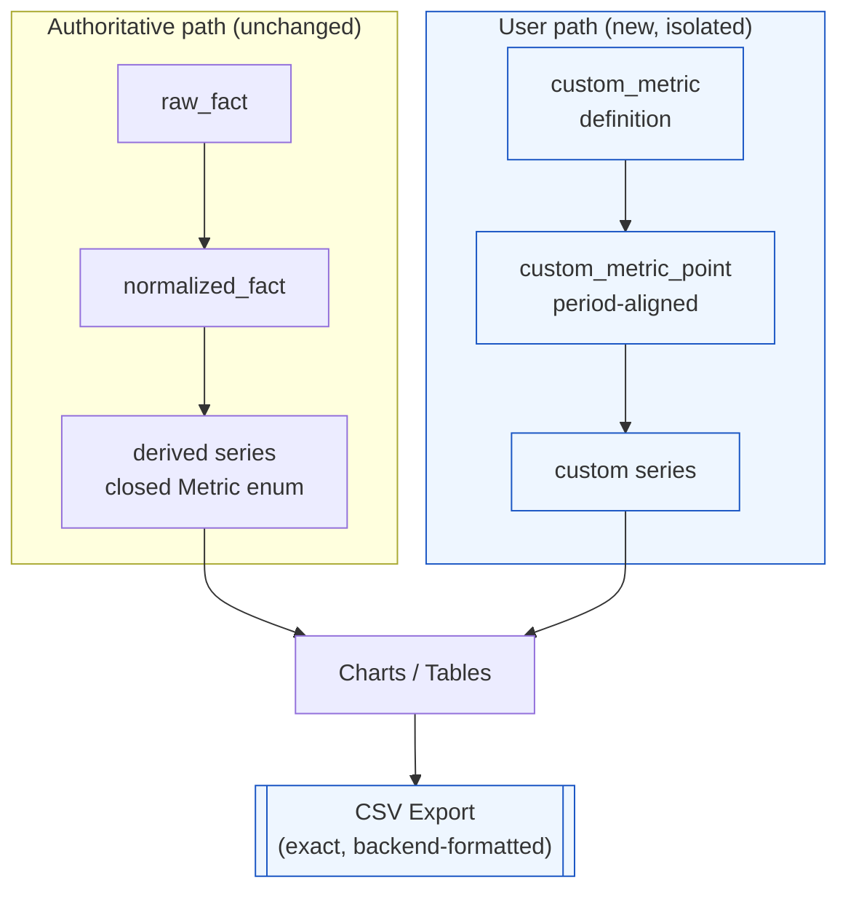
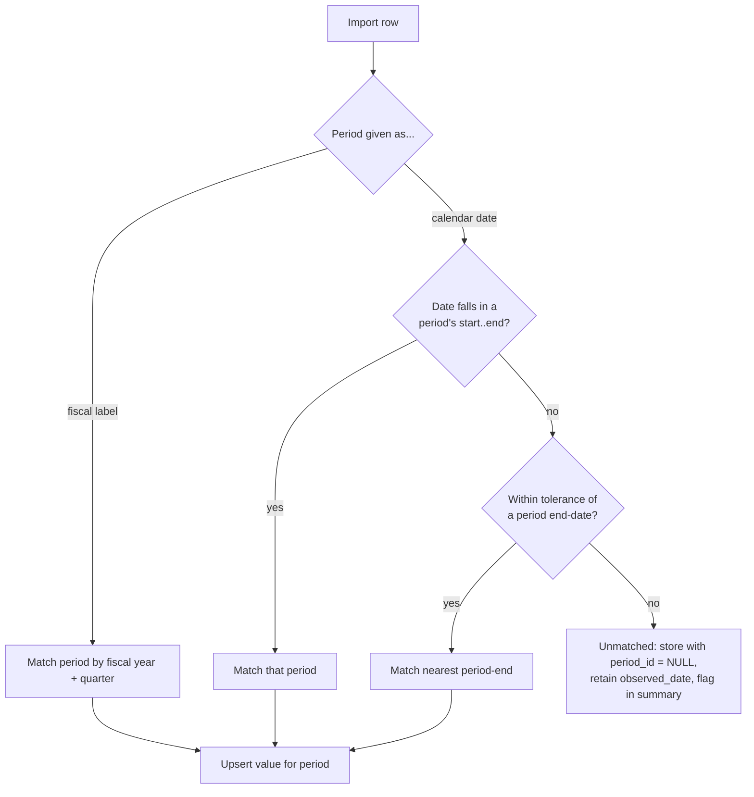
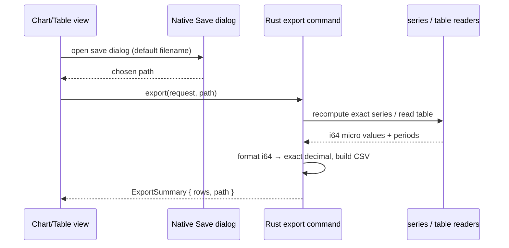
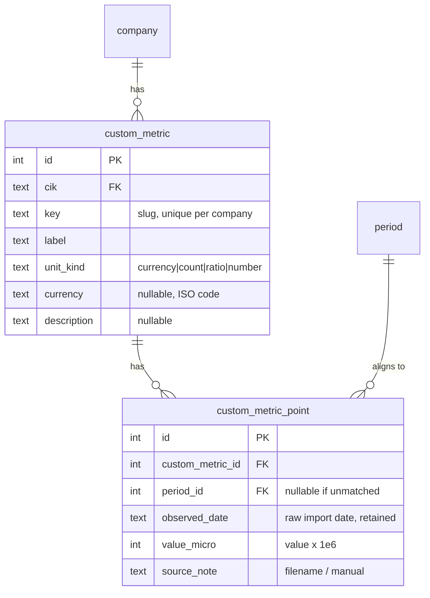

# DESIGN DOCUMENT

# CUSTOM METRICS & DATA EXPORT — PRODUCT **V2**

> Companion to `docs/custom-metrics-prd.md`. This document covers architecture,
> key decisions, and trade-offs at the module-boundary altitude. Concrete
> schema, class diagrams, IPC signatures, the file-level change plan, and test
> specifications live in `docs/custom-metrics-techspec.md`.
>
> **Version:** V2 product increment (see the PRD's *Version positioning*). The
> V1 architecture in `docs/architecture.md` is unchanged except for the
> additive, isolated modules described here.

---

# 1. CONTEXT: HOW THE EXISTING SYSTEM IS SHAPED

Three properties of the current architecture drive every decision below.

1. **The metric catalog is a closed enum.** `Metric` (Rust) is a fixed set of
   SEC-derived concepts, mirrored as a TypeScript union. `Metric::from_str`
   returns `None` for anything outside it. This is deliberate — it is part of
   the accuracy contract. Custom, user-defined names **cannot** be represented
   as `Metric` values.
2. **All data is company-scoped and fiscal-period-based.** A time series is a
   `Vec<MetricSeriesPoint>` where each point carries a `Period` (fiscal
   year/quarter). Charts render on a fiscal-period x-axis.
3. **Everything is authoritative and traceable.** Values flow
   `raw_fact → normalized_fact → derived series`, each with lineage back to a
   filing. Numbers are stored as integer **micro-units** (`value × 1_000_000`).

The design must add custom, non-authoritative, user-supplied data **without**
weakening any of these — and add export **without** rounding away precision.

---

# 2. KEY DECISIONS

## D1 — Custom metrics live in a separate, parallel store

Custom metrics are **not** shoehorned into the `Metric` enum or the
`normalized_fact` table. They get their own two tables — a **definition** and
its **observations** — that reference `company` and `period` but nothing in the
authoritative fact chain.

**Why:**
- Preserves the closed metric catalog and the accuracy contract (D5).
- The normalization/derivation engine needs **zero** changes.
- Custom data can never be confused with a filing-derived fact at the storage
  layer, so trust separation (D5) is structural, not merely cosmetic.

**Trade-off:** custom series need a small parallel read path (a second series
function) rather than reusing the normalized-fact one. This is cheap and worth
the isolation.

## D2 — Period alignment, with retained raw dates

The PRD chose **period-aligned** custom metrics. Each observation is resolved
to one of the company's fiscal `period` rows, so custom series share the exact
x-axis of built-in series and can be overlaid.

Resolution accepts either an explicit fiscal label (`FY2024`, `FY2024 Q2`) or a
calendar date. A date is resolved against the company's `period` calendar:

The **raw observed date is always retained**. Unmatched points are kept (not
dropped) and **re-resolved on the next ingestion/refresh**, when new periods may
have appeared. This honours FR-CM-004 ("never silently discard") and FR-040 in
the base PRD.

**Trade-off:** date→period resolution needs a tolerance rule for instant-style
KPIs reported at period end. We choose an explicit, documented rule (tech spec
§Resolution) and reject genuinely ambiguous rows rather than guess — consistent
with the app's "no fabricated estimates" principle.

## D3 — Values stored as integer micro-units, like everything else

Custom values are stored as `value × 1_000_000` in an `INTEGER` column,
matching the entire store. `unit_kind ∈ {currency, count, ratio, number}`
governs interpretation and display:

| unit_kind | Stored (micro) | Displayed | Example |
| --- | --- | --- | --- |
| `currency` | dollars × 1e6 | `$1.68T` | TPV |
| `count` | count × 1e6 | `25.1B`, `436M` | transactions, active accounts |
| `ratio` | ratio × 1e6 | `25.3%` | take-rate, net retention |
| `number` | value × 1e6 | `60.1` | transactions per active account |

`ratio` reuses the existing convention (`0.253 → 253_000`, rendered via the
existing `microToPercent`), so custom percentages render identically to
`operating_margin`.

**Trade-off — JS precision.** A micro value above `2^53` (≈ `$9B` or a count of
`9e9`) is not bit-exact once marshaled to a JavaScript `number`. This is **not
new** — Apple's revenue already exceeds it, and the app displays it correctly
because display is always rounded/compact. It only matters for the *validation*
use case, which is exactly why **export is backend-formatted from the i64
value** (D4) and never routed through a JS `number`.

## D4 — Export is generated in the backend, at full precision

Export commands run in Rust: they re-derive the exact series (reusing the same
series functions the charts use) or read the exact table, and format each `i64`
micro value to a full-precision decimal string. The frontend's role is only to
(a) obtain a destination path via the native Save dialog and (b) invoke the
export command.

**Why backend, not frontend:**
- **Precision (FR-EX-004).** Large micro values lose precision as JS `number`s;
  `i64 → decimal string` in Rust is exact. Validation demands exactness.
- **Single source of truth for formatting** — one place converts micro → units.
- **No new frontend file-system capability** is required; the existing Save
  dialog supplies a path and the backend writes it. (Writes are confined to
  explicit, user-initiated export intents.)

**Trade-off:** a handful of new IPC commands vs. duplicating precise formatting
in TypeScript. The backend approach is both safer (precision) and smaller.

## D5 — Structural trust separation

Custom metrics are surfaced with a distinct **"user data"** treatment and are
**excluded** from the lineage/traceability drawer. Their only provenance is
user-supplied (source filename, import timestamp). Because they live in a
separate store (D1) and never enter `normalized_fact`, the separation is
enforced by the data model, not just the UI. SEC ingestion and refresh never
read or write custom-metric values (they only trigger period **re-resolution**,
D2).

## D6 — Overlay via multi-axis charting

The comparison chart plots multiple period-aligned series on one fiscal-period
x-axis. Series are grouped onto y-axes by **unit family** (currency, count,
percentage, number) so a currency series and a count series don't share a
scale. This reuses the existing charting library's multi-axis support; no new
charting dependency.

**Scope bound for V1:** one "primary" series plus a small number of additional
series, with automatic left/right axis assignment by unit family. Rich
axis-configuration UI is out of scope.

---

# 3. MODULE BOUNDARIES

## 3.1 Backend (Rust)

| Area | Responsibility | New / changed |
| --- | --- | --- |
| `db/migrations` | Add the custom-metric tables | **New migration** |
| `domain` | `CustomMetric`, `CustomMetricPoint`, `UnitKind`, series point types | **New** |
| `repos` | CRUD + upsert for definitions and points; period-resolution reads | **New repo** |
| `derived`/`series` | A parallel custom-metric series reader (period-aligned) | **New function**, alongside existing |
| `pipeline` | Trigger custom-point re-resolution after ingest/refresh | **Small hook** |
| `export` | CSV generation for series, comparison, and tables | **New module** |
| `ipc/commands` | New commands for custom-metric CRUD, import, and export | **New commands** |

The authoritative pipeline (`sources`, `normalize`, `raw_fact`,
`normalized_fact`, `derived_metric`) is **not modified**, except for the small
re-resolution hook, which only touches custom tables.

## 3.2 Frontend (React/TypeScript)

| Area | Responsibility | New / changed |
| --- | --- | --- |
| `features/custom-metrics` | Panel, import dialog, metric editor, manual entry | **New** |
| `components/MetricChart` | Accept `unit_kind` for formatting | **Extended** |
| `components/ComparisonChart` | Multi-series, multi-axis overlay | **New** |
| `components/DownloadCsvButton` | Save-dialog + export-command affordance | **New** |
| `features/dashboard` | Mount custom-metrics panel; attach export buttons | **Extended** |
| `features/dashboard/StatementPage` | Attach table export | **Extended** |
| `api/client`, `api/types`, `state/queries` | New IPC bindings, types, queries | **Extended** |

## 3.3 Interaction with in-flight work

The IFRS/currency work-package is **schema-neutral** (its tech spec states "no
`fx_rate` migration"). This feature therefore claims the next migration version
(**`V2`**) without collision. Custom currency metrics store a currency code but
do **not** invoke the FX normalization path — they are user-supplied and
displayed in their stated currency as-is (a V-next enhancement could offer
optional conversion, explicitly out of scope here).

---

# 4. DATA MODEL (CONCEPTUAL)

Concrete `CREATE TABLE` statements, indexes, and uniqueness constraints are in
the tech spec.

---

# 5. ALTERNATIVES CONSIDERED

| Alternative | Why rejected |
| --- | --- |
| Extend the `Metric` enum with a "custom" variant | Breaks the closed-catalog accuracy contract; conflates authoritative and user data; requires the enum to carry runtime strings. |
| Store custom data in `normalized_fact` with a synthetic source | Pollutes the authoritative store; risks custom values appearing in lineage and derivations. |
| Raw-date (non-period) storage only | Rejected by the PRD decision — precludes overlay with built-in period series. We store raw dates *and* align to periods. |
| Frontend-generated CSV | Loses precision for large values via JS `number`; duplicates unit formatting. Backend generation is exact and centralized. |
| Full formula/expression engine for custom metrics | Explicit non-goal; custom metrics are imported data, not derivations. |

---

# 6. RISKS & MITIGATIONS

| Risk | Mitigation |
| --- | --- |
| Users perceive custom data as app-vouched/accurate | Structural + visual trust separation (D5); provenance only, no lineage. |
| Date→period resolution guesses wrong | Deterministic documented rule; reject ambiguous rows; retain raw date for re-resolution. |
| Precision loss in export | Backend `i64 → decimal` formatting (D4). |
| Accidental loss of hand-entered data on company delete | Explicit warning before destructive delete (FR-CM-010); export-before-delete is available. |
| Overlay charts become unreadable with many units | Axis grouping by unit family; bounded number of series in V1 (D6). |
