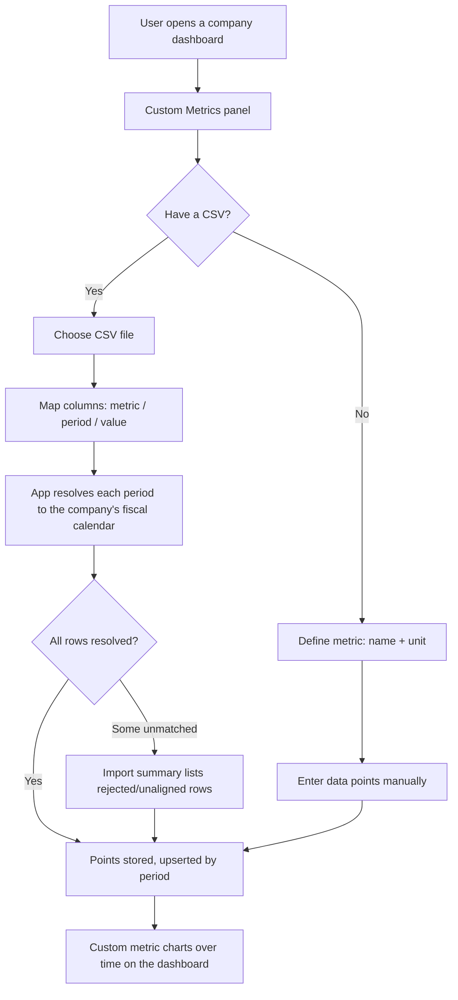

# PRODUCT REQUIREMENTS DOCUMENT (PRD)

# CUSTOM METRICS & DATA EXPORT — PRODUCT **V2**

> **Status:** Approved for design; implementation deferred to a Sonnet-class
> implementer working from the companion tech spec.
>
> **Version positioning.** This is the **V2 product increment**. It does *not*
> change V1 scope — the V1 non-goals in `docs/prd.md` §2.2 remain accurate for
> V1. Instead, V2 pulls two items forward from the V1 PRD's own backlog
> (`§15.2 V3` → CSV export; `§15.3 Long-Term` → custom dashboards/data) into a
> delivered V2 scope. See §9, *PRD Impact*.
>
> **Scope note.** This document defines two related capabilities requested
> together:
> - **Capability A — Custom Metrics:** let users import and track their own
>   business KPIs (e.g. PayPal's Total Payment Volume, active accounts)
>   alongside SEC-derived financials.
> - **Capability B — Data Export:** let users download any chart series or
>   table as CSV, for *both* custom metrics and the app's built-in metrics.
>
> They share a single theme — **user-owned data portability, in and out of the
> app on the user's terms** — and a single reversal of prior V1 non-goals, so
> they are documented as one feature.

---

# 1. PROBLEM & MOTIVATION

## 1.1 Capability A — Custom Metrics

Public companies routinely report **management-defined, non-financial key
metrics** in the MD&A section of their filings that never appear in the
structured XBRL financial statements the app ingests. These are the numbers
management itself uses to judge how the business is doing.

Concrete example (PayPal, 2025 Annual Report, Item 7 — *Key Metrics*):

| Metric | Meaning | Natural unit |
| --- | --- | --- |
| Total Payment Volume (TPV) | Value of payments completed on the platform | Currency |
| Number of payment transactions | Count of payments completed | Count |
| Active accounts | Accounts that transacted in the trailing 12 months | Count |
| Payment transactions per active account | Engagement ratio | Number |

A sophisticated investor tracking PayPal wants these trended over time next to
revenue and free cash flow — but the app has no way to hold them today, because
its metric catalog is a **fixed, closed set** of SEC-derived concepts.

The user need: **plug in your own metrics** — a name, a period, and a value —
and have the app store and chart them over time, per company. The app is
**not** responsible for how those numbers are gathered or whether they are
accurate; it is a **data store and a visualization surface** for numbers the
user vouches for.

## 1.2 Capability B — Data Export

The app renders precise numeric data (revenue, free cash flow yield over time,
etc.) but offers **no way to get those numbers out** in a numerical format.
Users need to:

1. **Validate** displayed figures against an independent source — which
   requires the *exact* underlying value, not a rounded `$3.83B` display label.
2. **Share** a series or table in a portable, tool-agnostic format (CSV).
3. **Re-use** the data elsewhere (a spreadsheet, a notebook).

This applies **generically** — to the app's built-in metrics (e.g. free cash
flow yield over time) just as much as to custom metrics.

---

# 2. GOALS AND NON-GOALS

## 2.1 Goals

### Capability A — Custom Metrics
1. Let users define custom metrics **per company**, each with a name and a unit.
2. Let users **import** custom metric data (period + value) via CSV.
3. Let users **manually enter and edit** individual data points.
4. **Align** each data point to the company's fiscal periods so custom metrics
   sit on the same time axis as built-in metrics.
5. **Chart** custom metrics over time, and allow **overlaying** a custom metric
   against a built-in metric on a shared period axis.
6. Keep custom (user-supplied) data **clearly distinct** from authoritative
   SEC-derived data, so the app's accuracy guarantee is never diluted.

### Capability B — Data Export
7. Let users **download any chart series as CSV** (built-in or custom).
8. Let users **download any financial table as CSV**.
9. Export **exact, full-precision** values (not rounded display labels).
10. Work **fully offline**, consistent with the local-first model.

## 2.2 Non-Goals

- **User-defined *formulas*.** Custom metrics are *imported data*, not computed
  derivations. There is no expression engine, no formula editor. (This remains
  a `docs/prd.md` non-goal.)
- **Accuracy responsibility for custom data.** The app does not validate,
  reconcile, or attach lineage to user-imported values. It stores what it is
  given.
- **Automatic scraping of KPIs from filings.** The app does not extract custom
  metrics from MD&A text. The user supplies the numbers.
- **Cross-company custom metrics / shared definitions.** Each custom metric
  belongs to exactly one company in V1.
- **Cloud sync / sharing of custom metrics between machines or users.**
- **PDF / image export.** Only CSV (numerical) export is in scope. (PDF/image
  export remain `docs/prd.md` non-goals.)
- **Import formats other than CSV** (XLSX, JSON, API pull) in V1.

---

# 3. USERS & PERSONAS

Both capabilities serve the existing personas from `docs/prd.md` §4 — the
Long-Term Fundamental Investor and the Independent Financial Researcher — with
no new persona. Custom metrics matter most to the fundamental investor who
tracks operational KPIs; export matters most to the researcher who wants
reproducible, verifiable datasets.

---

# 4. USER WORKFLOWS

## 4.1 Custom Metric — Define & Import

## 4.2 Custom Metric — Overlay Analysis

1. User selects a built-in metric (e.g. Revenue).
2. User adds one or more custom metrics (e.g. TPV, Active Accounts).
3. App plots all series on a **shared fiscal-period x-axis**, grouping
   different units onto separate y-axes (currency vs. count vs. percentage).
4. User visually correlates operational KPIs with financial results.

## 4.3 Data Export — Download a Series or Table

---

# 5. FUNCTIONAL REQUIREMENTS

## 5.1 Custom Metrics

### FR-CM-001 — Define Custom Metric
Users must be able to create a custom metric scoped to a single company, with:
a display name, a **unit kind** (currency, count, ratio/percentage, or plain
number), and an optional description/definition note.

### FR-CM-002 — CSV Import
Users must be able to import custom metric data from a CSV file. The importer
must accept a **period identifier** (fiscal label such as `FY2024` or
`FY2024 Q2`, **or** a calendar date) and a **value** per row, and may create or
update multiple metrics in one file (long format: metric, period, value).

### FR-CM-003 — Period Alignment
Each imported/entered data point must be resolved to one of the company's
fiscal periods (annual or quarterly). Both annual and quarterly data must be
supported for the same metric.

### FR-CM-004 — Transparent Import Results
The importer must **never silently discard** rows. Every row is reported as
imported, updated, or rejected (with a reason: unparseable, no matching fiscal
period, duplicate). Unmatched rows are retained so they can be re-aligned after
a later ingestion adds the relevant period. *(Consistent with `docs/prd.md`
FR-040.)*

### FR-CM-005 — Manual Entry & Editing
Users must be able to add, edit, and delete individual data points and metric
definitions in the UI, without a CSV.

### FR-CM-006 — Idempotent Re-import
Re-importing data for an existing (metric, period) must **update** the value,
not create duplicates.

### FR-CM-007 — Charting
Custom metrics must chart over time on the company dashboard, using
unit-appropriate formatting (currency, count, percentage, or decimal number).

### FR-CM-008 — Overlay With Built-in Metrics
Users must be able to overlay a custom metric against a built-in metric (and
against other custom metrics) on a shared fiscal-period x-axis, with distinct
y-axes per unit family.

### FR-CM-009 — Trust Separation
Custom (user-supplied) metrics must be **visually distinguished** from
authoritative SEC-derived metrics and must be **excluded** from the app's
source-lineage/traceability guarantees. Custom data must never enter the
normalization pipeline or be presented as filing-derived. The most the app
records is user-supplied provenance (e.g. source filename, import timestamp).

### FR-CM-010 — Deletion Safety
Deleting a company or a custom metric must warn the user when user-authored
custom data will be lost, since that data is not re-derivable from filings.

## 5.2 Data Export

### FR-EX-001 — Series Export
Any single-metric time-series chart — built-in or custom — must offer a
"Download CSV" action producing one row per period.

### FR-EX-002 — Comparison Export
The overlay/comparison chart must export a CSV with one column per series,
aligned by period.

### FR-EX-003 — Table Export
Financial-statement tables must offer a "Download CSV" action producing the
table as shown (metrics × periods).

### FR-EX-004 — Full Precision
Exported values must be **exact** — the full-precision underlying number, not
the compact display label (e.g. `383285000000.00`, not `$383.29B`). This is
essential to the validation use case.

### FR-EX-005 — Unit Clarity
Exported CSVs must make units unambiguous: currency values in currency units
with a currency column, ratio/percentage metrics expressed as a percentage
(and/or decimal), counts as integers.

### FR-EX-006 — Period Context
Series exports must include enough period context to be self-describing: the
period label, fiscal year, fiscal quarter, and period start/end dates.

### FR-EX-007 — Offline
Export must function with no network connection.

### FR-EX-008 — What-you-see
Export produces exactly the data shown in the originating view (same metric,
same annual/quarterly mode, same periods).

---

# 6. UX REQUIREMENTS

- Consistent with `docs/prd.md` §10: dense, professional, analytical, minimal.
- Custom metrics live in a clearly labelled area of the dashboard, badged as
  **user-supplied**.
- "Download CSV" is a small, consistent affordance attached to every eligible
  chart and table — never a modal-heavy flow.
- Import surfaces a clear results summary; errors are explicit and per-row.

---

# 7. SUCCESS CRITERIA

1. A user can import PayPal's four key metrics from a CSV and see each charted
   over time within one workflow, with any unmatched rows explicitly reported.
2. A user can overlay TPV against Revenue on one chart with correct dual axes.
3. A user can download the free-cash-flow-yield series and the custom TPV
   series as CSVs whose values match the exact stored numbers.
4. No custom metric is ever presented as SEC-sourced or shown with filing
   lineage.
5. All of the above work offline.

---

# 8. EDGE CASES

- **Company not yet ingested / no periods:** custom-metric import requires the
  company's fiscal periods to exist; if none do, the importer reports rows as
  unaligned and retains them for later re-alignment.
- **Date that spans a period boundary:** resolved deterministically (see design
  doc); ambiguous rows are rejected with a reason, not guessed.
- **Very large counts / currency values:** exported at full precision from the
  authoritative integer store (see design doc §4 on the precision guarantee).
- **Re-ingestion changing the fiscal calendar:** stored custom points retain
  their original observed date and are re-resolved to periods on refresh.
- **Ratio/percentage inputs:** the importer must know whether a value is a
  decimal ratio (`0.253`) or a percentage (`25.3`); this is a per-metric
  setting, not guessed per row.

---

# 9. PRD IMPACT (`docs/prd.md`)

This is a **V2 increment**, so the V1 PRD's scope and non-goals stay intact and
accurate *for V1*. Per the standing PRD-update protocol, `docs/prd.md` is
updated only to record that these previously-backlogged items are now scheduled
into V2:

1. **§2.2 Non-Goals:** annotate the *CSV export* and *Custom widgets* lines as
   "*(V1 non-goal; delivered in V2 — see `docs/custom-metrics-prd.md`)*". The
   lines themselves remain, because they still describe V1.
2. **§15.1 (V2 Enhancements):** add **Custom metrics (user-imported KPIs)** and
   **CSV export** as in-scope V2 items, with a pointer to this doc set.
3. **§15.2 (V3):** remove **CSV export** (promoted to V2); **spreadsheet
   interoperability** and **chart/image export** remain V3.

What stays a non-goal in V2 as well: **user-defined formulas**, a **plugin
ecosystem**, **PDF/image export**, and **cross-company / cloud-synced** custom
metrics (§2.2 above).

---

# 10. OPEN QUESTIONS

None blocking. Deferred to design:
- Exact CSV column layout for comparison exports (documented in design doc).
- Whether manual entry ships in the same release as CSV import (assumed yes —
  it is low-cost given the same storage path).
