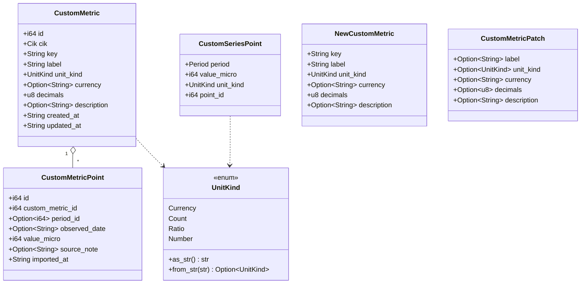
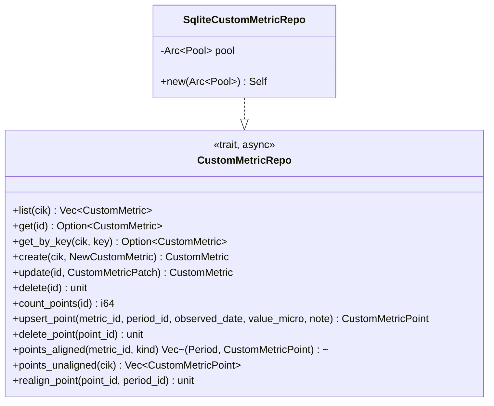
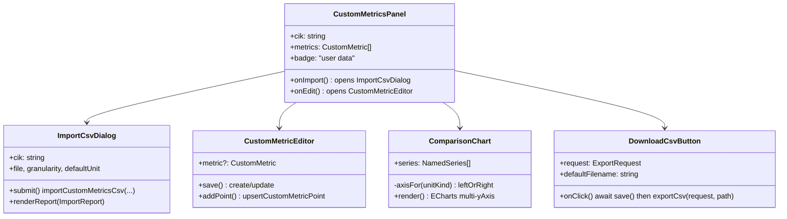

# TECHNICAL SPECIFICATION

# CUSTOM METRICS & DATA EXPORT — PRODUCT **V2**

> Implementation-ready companion to `docs/custom-metrics-prd.md` and
> `docs/custom-metrics-design.md`. This document is written to be handed to a
> Sonnet-class implementer: it gives exact schema, types, trait/IPC signatures,
> algorithms, a file-level change table, work packages, and concrete test
> specifications. Conventions follow the existing V1 codebase
> (`docs/tech_spec.md`): integer **micro-units** (`value × 1_000_000`),
> `async_trait` repositories over an `Arc<Pool>`, `#[tauri::command]` IPC
> returning `Result<T, AppError>`, and a hand-synced TypeScript mirror.

---

# 1. MODULE MAP

New/changed backend modules (Rust, `src-tauri/src`):

| Module | Kind | Purpose |
| --- | --- | --- |
| `db/migrations/V2__custom_metrics.sql` | **new** | Custom-metric tables + indexes |
| `domain/custom_metric.rs` | **new** | `CustomMetric`, `CustomMetricPoint`, `UnitKind`, series/report types |
| `domain/mod.rs` | edit | `pub mod custom_metric;` + re-exports |
| `repos/custom_metric.rs` | **new** | `CustomMetricRepo` trait + `SqliteCustomMetricRepo` |
| `repos/mod.rs` | edit | `pub mod custom_metric;` |
| `derived/custom_series.rs` | **new** | Period-aligned custom-metric series reader |
| `import/mod.rs`, `import/csv.rs`, `import/resolve.rs` | **new** | CSV parse + period resolution |
| `export/mod.rs`, `export/csv.rs` | **new** | Pure CSV renderers (series/comparison/table) |
| `pipeline/orchestrator.rs` | edit | Post-ingest custom-point re-resolution hook |
| `ipc/commands.rs` | edit | New commands (§7) |
| `ipc/mod.rs` (`handler()`, `AppState`) | edit | Register commands; add `custom_metrics` repo to state |

New/changed frontend modules (TypeScript, `src`):

| Module | Kind | Purpose |
| --- | --- | --- |
| `features/custom-metrics/CustomMetricsPanel.tsx` | **new** | List + manage a company's custom metrics |
| `features/custom-metrics/ImportCsvDialog.tsx` | **new** | Upload + column-map + import summary |
| `features/custom-metrics/CustomMetricEditor.tsx` | **new** | Define/edit a metric; manual point entry |
| `components/ComparisonChart.tsx` | **new** | Multi-series, multi-axis overlay |
| `components/DownloadCsvButton.tsx` | **new** | Save-dialog + `export_csv` affordance |
| `components/MetricChart.tsx` | edit | Accept `unitKind` for formatting |
| `features/dashboard/CompanyDashboardPage.tsx` | edit | Mount panel; attach export buttons |
| `features/dashboard/MetricDrillPage.tsx`, `StatementPage.tsx` | edit | Attach export buttons |
| `api/types.ts`, `api/client.ts`, `state/queries.ts` | edit | Types, bindings, queries |

The authoritative V1 pipeline (`sources`, `normalize`, `raw_fact`,
`normalized_fact`, `derived_metric`, `derived/series.rs`) is **not modified**
except the single re-resolution hook, which only touches custom tables.

---

# 2. DATA MODEL — MIGRATION `V2__custom_metrics.sql`

```sql
-- V2. Custom metrics (user-supplied, per-company, period-aligned).
-- Separate from the authoritative normalized_fact chain by design: custom
-- values never enter normalization and carry no filing lineage.
-- Values stored as INTEGER micro-units (× 1,000,000), consistent with V1.

CREATE TABLE IF NOT EXISTS custom_metric (
  id            INTEGER PRIMARY KEY AUTOINCREMENT,
  cik           TEXT NOT NULL REFERENCES company(cik) ON DELETE RESTRICT,
  key           TEXT NOT NULL,              -- slug: ^[a-z0-9][a-z0-9_]*$
  label         TEXT NOT NULL,              -- display name, e.g. "Total Payment Volume"
  unit_kind     TEXT NOT NULL,             -- 'currency' | 'count' | 'ratio' | 'number'
  currency      TEXT,                      -- ISO 4217 when unit_kind='currency' (default 'USD')
  decimals      INTEGER NOT NULL DEFAULT 2,-- display precision for 'number'/'ratio'
  description   TEXT,                       -- optional user definition/note
  created_at    TEXT NOT NULL,             -- RFC3339
  updated_at    TEXT NOT NULL,
  CHECK (unit_kind IN ('currency','count','ratio','number')),
  UNIQUE (cik, key)
);
CREATE INDEX IF NOT EXISTS idx_custom_metric_cik ON custom_metric(cik);

CREATE TABLE IF NOT EXISTS custom_metric_point (
  id               INTEGER PRIMARY KEY AUTOINCREMENT,
  custom_metric_id INTEGER NOT NULL REFERENCES custom_metric(id) ON DELETE RESTRICT,
  period_id        INTEGER REFERENCES period(id) ON DELETE SET NULL,  -- NULL = unaligned
  observed_date    TEXT,                    -- raw import date (RFC3339 date), retained for re-resolution
  value_micro      INTEGER NOT NULL,        -- value × 1e6 (i64)
  source_note      TEXT,                    -- filename or 'manual'
  imported_at      TEXT NOT NULL,
  -- At most one point per (metric, period) when aligned; unaligned points
  -- (period_id IS NULL) are disambiguated by observed_date.
  UNIQUE (custom_metric_id, period_id),
  UNIQUE (custom_metric_id, observed_date)
);
CREATE INDEX IF NOT EXISTS idx_cmp_metric_period
  ON custom_metric_point(custom_metric_id, period_id);
CREATE INDEX IF NOT EXISTS idx_cmp_unaligned
  ON custom_metric_point(custom_metric_id)
  WHERE period_id IS NULL;
```

**Deletion semantics (FR-CM-010).** FKs are `RESTRICT` to match V1. The
`CompanyRepo::remove` path (and a new `CustomMetricRepo::delete`) delete child
rows explicitly in dependency order inside the existing transaction. The UI
(`remove_company`, custom-metric delete) must first warn when custom points
exist (see §7 `count_custom_points`). `ON DELETE SET NULL` on `period_id` lets a
period be pruned/re-created during refresh without destroying the user's value —
the point becomes unaligned and is re-resolved (§5).

---

# 3. DOMAIN TYPES (Rust) — `domain/custom_metric.rs`



All structs derive `Debug, Clone, Serialize, Deserialize`. `UnitKind` serializes
to its snake/lower `as_str()` form (`"currency"`, `"count"`, `"ratio"`,
`"number"`) to mirror the TS union.

**Value scaling helpers** (pure, unit-tested):

```rust
/// Parse a user decimal string into micro-units (×1e6), exact for typical
/// inputs. Rejects non-finite / non-numeric. Accepts leading '+/-', commas as
/// thousands separators are stripped first.
pub fn parse_micro(input: &str) -> Result<i64, ParseValueError>;

/// Format an i64 micro value to an exact decimal string with `min_frac`..6
/// fractional digits (trailing zeros trimmed down to `min_frac`). Exact for all
/// i64 — never routed through f64 (this is the precision guarantee, D4).
pub fn micro_to_decimal_string(v: i64, min_frac: u8) -> String;

/// Format an i64 ratio-micro value (ratio × 1e6) as an exact percent string.
/// e.g. 41_234 → "4.1234", 253_000 → "25.3".
pub fn ratio_micro_to_percent_string(v: i64) -> String;
```

---

# 4. REPOSITORY — `repos/custom_metric.rs`



Trait signature (abbreviated; `RepoError` per V1):

```rust
#[async_trait]
pub trait CustomMetricRepo: Send + Sync {
    async fn list(&self, cik: &Cik) -> Result<Vec<CustomMetric>, RepoError>;
    async fn get(&self, id: i64) -> Result<Option<CustomMetric>, RepoError>;
    async fn get_by_key(&self, cik: &Cik, key: &str) -> Result<Option<CustomMetric>, RepoError>;
    async fn create(&self, cik: &Cik, def: &NewCustomMetric) -> Result<CustomMetric, RepoError>;
    async fn update(&self, id: i64, patch: &CustomMetricPatch) -> Result<CustomMetric, RepoError>;
    async fn delete(&self, id: i64) -> Result<(), RepoError>;         // deletes points first
    async fn count_points(&self, id: i64) -> Result<i64, RepoError>;

    /// Upsert by (metric, period). period_id=None stores an unaligned point
    /// keyed by observed_date. Returns the stored row.
    async fn upsert_point(
        &self, metric_id: i64, period_id: Option<i64>,
        observed_date: Option<&str>, value_micro: i64, note: Option<&str>,
    ) -> Result<CustomMetricPoint, RepoError>;
    async fn delete_point(&self, point_id: i64) -> Result<(), RepoError>;

    /// Aligned points for a metric, joined to their Period, filtered by kind
    /// (annual|quarterly), sorted by Period.end_date.
    async fn points_aligned(&self, metric_id: i64, kind: PeriodKind)
        -> Result<Vec<(Period, CustomMetricPoint)>, RepoError>;

    /// All unaligned points for a company's metrics (for re-resolution).
    async fn points_unaligned(&self, cik: &Cik) -> Result<Vec<CustomMetricPoint>, RepoError>;
    async fn realign_point(&self, point_id: i64, period_id: i64) -> Result<(), RepoError>;
}
```

`upsert_point` semantics (FR-CM-006): `INSERT ... ON CONFLICT(custom_metric_id,
period_id) DO UPDATE SET value_micro=excluded.value_micro, ...`. For unaligned
points the conflict target is `(custom_metric_id, observed_date)`.

---

# 5. PERIOD RESOLUTION — `import/resolve.rs`

Resolution turns a `period` token (or bare date) + a declared **granularity**
(`annual` | `quarterly`) into a `period_id`, using the company's `period` rows.

```mermaid
flowchart TD
  T[token, granularity, company periods] --> K{token shape}
  K -- "FY2024 / 2024" --> A[granularity=annual → match fiscal_year=2024, quarter=0]
  K -- "FY2024 Q2 / 2024-Q2" --> B[match fiscal_year=2024, quarter=2]
  K -- "YYYY-MM-DD" --> D{exact period.end_date == date<br/>for granularity?}
  D -- yes --> M[match]
  D -- no --> C{date in [start_date,end_date]<br/>for a period of granularity?}
  C -- yes --> M
  C -- no --> N{within ±TOL days of a<br/>period end_date of granularity?}
  N -- yes --> M
  N -- no --> U[Unmatched]
  A --> R{found?}
  B --> R
  R -- yes --> M
  R -- no --> U
```

- `TOL = 45` days (documented constant; covers period-end reporting where the
  user's date is a filing/announcement date near period close).
- A token that encodes a quarter (`Q2`) overrides the declared granularity to
  `quarterly`; a bare year forces `annual`.
- **Ambiguity is an error, not a guess.** If a bare date matches two periods of
  the same granularity (should not happen for well-formed calendars) → row
  error `ambiguous_period`.
- **Unmatched** (no period at all) → the point is stored with `period_id=NULL`
  and its `observed_date`, and reported as `unaligned` (not an error).

```rust
pub enum Resolution { Matched(i64 /*period_id*/), Unaligned, Error(ResolveError) }
pub fn resolve_period(
    token: &str, granularity: PeriodKind, periods: &[Period],
) -> Resolution;
```

**Re-resolution hook (D2).** After a successful ingest/refresh,
`pipeline::orchestrator` calls, for the ingested `cik`:
`for p in repo.points_unaligned(cik) { if let Matched(pid) = resolve_period(p.observed_date, granularity_of(p), &periods) { repo.realign_point(p.id, pid) } }`.
Granularity for a stored point is inferred from its metric's imported points or
stored alongside the point (implementer may add a nullable `granularity` column
if inference is undesirable — noted as an allowed refinement).

---

# 6. CSV IMPORT — `import/csv.rs`

**Accepted file shape (long format).** Header row, case-insensitive,
order-independent. Delimiter `,`; quoting per RFC 4180.

| Column | Required | Notes |
| --- | --- | --- |
| `metric` | yes | Metric key (slug) or exact label; created if new |
| `period` | yes | Period token (see §5) |
| `value` | yes | Decimal; commas stripped |
| `unit` | for new metric | `currency`\|`count`\|`ratio`\|`percent`\|`number` |
| `label` | no | Display name for a new metric |
| `currency` | no | ISO code (unit=currency); default USD |

**Import options** (`ImportOptions`): `granularity: "annual"|"quarterly"`
(default annual), `default_unit: UnitKind` (fallback when `unit` column absent
and metric is new; default `number`).

**Unit token normalization:** `percent` is sugar — stored `unit_kind=ratio`
with `value_micro = round(value/100 * 1e6)`. `ratio` stores
`value_micro = round(value * 1e6)`. `currency`/`count`/`number` store
`value_micro = round(value * 1e6)`.

**Row outcome** (`ImportRowResult`): one of
`Imported | Updated | Unaligned | Rejected{reason}`. Rejection reasons:
`missing_column`, `bad_value`, `bad_period`, `ambiguous_period`,
`unit_conflict` (unit column disagrees with an existing metric's unit).

```rust
pub struct ImportReport {
    pub metrics_created: Vec<String>,   // keys
    pub imported: u32,
    pub updated: u32,
    pub unaligned: u32,
    pub rejected: Vec<ImportRowResultDetail>, // {row_index, reason, raw}
}
```

The parser **never aborts the whole file** on a bad row (FR-CM-004): it
collects per-row results and applies the good rows in one transaction.

---

# 7. IPC COMMAND CATALOG

All commands `#[tauri::command] async` returning `Result<T, AppError>`. TS
bindings in `api/client.ts` use `invoke("name", { camelCaseArgs })`.

## 7.1 Custom metrics

| Command | Rust args | Returns | TS binding |
| --- | --- | --- | --- |
| `list_custom_metrics` | `cik: String` | `Vec<CustomMetric>` | `listCustomMetrics(cik)` |
| `create_custom_metric` | `cik: String, def: NewCustomMetric` | `CustomMetric` | `createCustomMetric(cik, def)` |
| `update_custom_metric` | `id: i64, patch: CustomMetricPatch` | `CustomMetric` | `updateCustomMetric(id, patch)` |
| `delete_custom_metric` | `id: i64` | `()` | `deleteCustomMetric(id)` |
| `count_custom_points` | `id: i64` | `i64` | `countCustomPoints(id)` |
| `get_custom_metric_series` | `cik: String, metric_id: i64, kind: String` | `Vec<CustomSeriesPoint>` | `getCustomMetricSeries(cik, metricId, kind)` |
| `upsert_custom_metric_point` | `metric_id: i64, period: String, kind: String, value: String` | `CustomMetricPoint` | `upsertCustomMetricPoint(metricId, period, kind, value)` |
| `delete_custom_metric_point` | `point_id: i64` | `()` | `deleteCustomMetricPoint(pointId)` |
| `import_custom_metrics_csv` | `cik: String, csv_text: String, options: ImportOptions` | `ImportReport` | `importCustomMetricsCsv(cik, csvText, options)` |

## 7.2 Export

Single command over a tagged request (`#[serde(tag = "type")]`):

```rust
#[serde(tag = "type", rename_all = "snake_case")]
pub enum ExportRequest {
    MetricSeries      { cik: String, metric: String, kind: String },
    CustomMetricSeries{ cik: String, metric_id: i64, kind: String },
    Comparison        { cik: String, series: Vec<SeriesRef>, kind: String },
    Statement         { cik: String, statement: String, kind: String }, // income|balance|cash_flow
}
pub struct SeriesRef { pub source: String /* "builtin"|"custom" */, pub key: String }
pub struct ExportReport { pub rows: u32, pub bytes: u64, pub path: String }
```

| Command | Rust args | Returns | TS binding |
| --- | --- | --- | --- |
| `render_csv` | `request: ExportRequest` | `String` | `renderCsv(request)` — **pure**, for preview/test |
| `export_csv` | `request: ExportRequest, dest_path: String` | `ExportReport` | `exportCsv(request, destPath)` |

`export_csv` = `render_csv` + write to `dest_path` (obtained via the existing
`@tauri-apps/plugin-dialog` `save()`; the plugin is already registered in
`lib.rs`). Keeping `render_csv` pure makes CSV content unit-testable without the
filesystem.

## 7.3 CSV output formats (exact)

**Series** (`MetricSeries` / `CustomMetricSeries`):
```
metric,unit,period_label,period_kind,fiscal_year,fiscal_quarter,period_start,period_end,value[,currency]
free_cash_flow_yield,percent,FY2024,annual,2024,0,2023-10-01,2024-09-30,4.1234
```
- `value` in the metric's natural unit: currency→exact decimal via
  `micro_to_decimal_string(v, 2)`; count/number→`micro_to_decimal_string(v, 0/decimals)`;
  ratio/percent→`ratio_micro_to_percent_string(v)`.
- `currency` column present only when `unit=currency`.

**Comparison** (`Comparison`): wide, one column per series, aligned by period
(period present in any series; missing cells empty):
```
period_label,period_kind,fiscal_year,fiscal_quarter,period_end,revenue [USD],tpv [USD],active_accounts [count]
FY2024,annual,2024,0,2024-09-30,383285000000.00,1680000000000.00,436000000
```

**Statement** (`Statement`): matrix, metrics as rows, periods as columns
(mirrors `StatementPage`):
```
metric,unit,FY2020,FY2021,FY2022,FY2023,FY2024
revenue,currency,...,...,...,...,...
net_income,currency,...
```

---

# 8. CUSTOM SERIES READ PATH — `derived/custom_series.rs`

Parallel to `derived/series.rs` but trivial (no derivation — pass-through of
stored points):

```rust
pub async fn custom_metric_series(
    repo: &dyn CustomMetricRepo, metric_id: i64, kind: PeriodKind,
) -> Result<Vec<CustomSeriesPoint>, AppError> {
    let metric = repo.get(metric_id).await?.ok_or_else(|| AppError::not_found("custom metric"))?;
    let pts = repo.points_aligned(metric_id, kind).await?;      // already sorted by end_date
    Ok(pts.into_iter().map(|(period, p)| CustomSeriesPoint {
        period, value_micro: p.value_micro, unit_kind: metric.unit_kind, point_id: p.id,
    }).collect())
}
```

Unaligned points are intentionally excluded from the series (they have no
x-position); they surface in the panel's "N unaligned" indicator.

---

# 9. FRONTEND CONTRACTS

## 9.1 Types (`api/types.ts`, additions)

```ts
export type UnitKind = "currency" | "count" | "ratio" | "number";

export interface CustomMetric {
  id: number; cik: Cik; key: string; label: string;
  unit_kind: UnitKind; currency?: string | null; decimals: number;
  description?: string | null; created_at: string; updated_at: string;
}
export interface CustomMetricPoint {
  id: number; custom_metric_id: number; period_id?: number | null;
  observed_date?: string | null; value_micro: number;
  source_note?: string | null; imported_at: string;
}
export interface CustomSeriesPoint { period: Period; value_micro: number; unit_kind: UnitKind; point_id: number; }
export interface NewCustomMetric { key: string; label: string; unit_kind: UnitKind; currency?: string | null; decimals?: number; description?: string | null; }
export interface ImportOptions { granularity: PeriodKind; default_unit: UnitKind; }
export interface ImportReport { metrics_created: string[]; imported: number; updated: number; unaligned: number; rejected: { row_index: number; reason: string; raw: string }[]; }
export type ExportRequest =
  | { type: "metric_series"; cik: string; metric: string; kind: PeriodKind }
  | { type: "custom_metric_series"; cik: string; metric_id: number; kind: PeriodKind }
  | { type: "comparison"; cik: string; series: { source: "builtin" | "custom"; key: string }[]; kind: PeriodKind }
  | { type: "statement"; cik: string; statement: "income" | "balance" | "cash_flow"; kind: PeriodKind };
export interface ExportReport { rows: number; bytes: number; path: string; }
```

Formatting helper additions: `fmtCustomValue(unitKind, micro, decimals)` reusing
`fmtUsdCompact` (currency), a compact-count formatter (count), `fmtPercent`
(ratio), and a fixed-decimals formatter (number).

## 9.2 Component responsibilities & class view



- **`DownloadCsvButton`** is attached to: each `MetricChart` (drill + dashboard),
  `ComparisonChart`, and `StatementPage` table. Filename default:
  `{ticker}_{key}_{kind}.csv` (comparison: `{ticker}_comparison_{kind}.csv`;
  statement: `{ticker}_{statement}_{kind}.csv`).
- **Trust separation (FR-CM-009):** `CustomMetricsPanel` renders a persistent
  "user data" badge; custom charts do **not** wire the `LineageDrawer`. The
  lineage/`get_lineage` path is untouched and never called for custom metrics.

## 9.3 Queries (`state/queries.ts`)

Add query keys `["custom-metrics", cik]`, `["custom-series", cik, metricId, kind]`
and mutations for create/update/delete/import that invalidate them. Company
refresh must also invalidate `custom-series` (re-resolution may realign points).

---

# 10. FILE-LEVEL CHANGE TABLE

| File | Action | Summary |
| --- | --- | --- |
| `src-tauri/src/db/migrations/V2__custom_metrics.sql` | add | §2 schema |
| `src-tauri/src/db/mod.rs` | edit | register V2 migration in the ordered list |
| `src-tauri/src/domain/custom_metric.rs` | add | §3 types + helpers |
| `src-tauri/src/domain/mod.rs` | edit | module + re-exports |
| `src-tauri/src/repos/custom_metric.rs` | add | §4 repo |
| `src-tauri/src/repos/mod.rs` | edit | module |
| `src-tauri/src/derived/custom_series.rs` | add | §8 reader |
| `src-tauri/src/derived/mod.rs` | edit | module |
| `src-tauri/src/import/{mod,csv,resolve}.rs` | add | §5–§6 |
| `src-tauri/src/export/{mod,csv}.rs` | add | §7.3 renderers |
| `src-tauri/src/lib.rs` | edit | `pub mod import; pub mod export;` |
| `src-tauri/src/pipeline/orchestrator.rs` | edit | §5 re-resolution hook |
| `src-tauri/src/ipc/commands.rs` | edit | §7 commands |
| `src-tauri/src/ipc/mod.rs` | edit | `handler![]` list + `AppState.custom_metrics` |
| `src/api/types.ts` | edit | §9.1 |
| `src/api/client.ts` | edit | §7 bindings |
| `src/state/queries.ts` | edit | §9.3 |
| `src/components/{DownloadCsvButton,ComparisonChart}.tsx` | add | §9.2 |
| `src/components/MetricChart.tsx` | edit | `unitKind` prop |
| `src/features/custom-metrics/*.tsx` | add | §9.2 |
| `src/features/dashboard/{CompanyDashboardPage,MetricDrillPage,StatementPage}.tsx` | edit | mount panel + export buttons |

---

# 11. WORK PACKAGES

Ordered for incremental, independently-testable delivery. Each WP ends with its
tests green (see §12).

| WP | Title | Depends on | Deliverable |
| --- | --- | --- | --- |
| **WP-1** | Schema + domain types | — | V2 migration, `domain/custom_metric.rs`, scaling helpers + unit tests |
| **WP-2** | Repository | WP-1 | `CustomMetricRepo` + Sqlite impl + repo tests |
| **WP-3** | Period resolution | WP-1 | `import/resolve.rs` + resolution unit tests |
| **WP-4** | CSV import | WP-2, WP-3 | `import/csv.rs` + `import_custom_metrics_csv` command + tests |
| **WP-5** | Custom series + IPC CRUD | WP-2 | `custom_series.rs`, CRUD/series commands, TS bindings/types |
| **WP-6** | Export renderers + command | WP-5 | `export/*` (`render_csv` pure) + `export_csv` + tests |
| **WP-7** | Re-resolution hook | WP-3, WP-5 | orchestrator hook + integration test |
| **WP-8** | Frontend: panel/import/editor | WP-5 | custom-metrics feature UI + vitest |
| **WP-9** | Frontend: charts + export buttons | WP-6, WP-8 | `ComparisonChart`, `DownloadCsvButton`, `MetricChart` unit prop, wiring |
| **WP-10** | E2E + docs sync | all | E2E flows; update `docs/prd.md` §15 + `architecture.md` note |

---

# 12. TEST SPECIFICATION

Concrete, implementer-ready. Backend: Rust `#[test]`/`#[tokio::test]` with an
in-memory migrated DB helper (`test_db()` seeding a company + periods). Frontend:
vitest + `@testing-library/react` with the existing `src/test-mock-tauri.ts`.
E2E: the existing WebDriver/Playwright harness. Real ingested companies in the
production SQLite (`~/Library/Application Support/com.econproject.app/data.sqlite`)
back the offline accuracy checks.

## 12.1 Unit — value helpers (`domain/custom_metric.rs`)

| Test | Input | Expected |
| --- | --- | --- |
| `parse_micro_integer` | `"25000000000"` | `25_000_000_000_000_000` |
| `parse_micro_decimal` | `"25.3"` | `25_300_000` |
| `parse_micro_strips_commas` | `"1,680,000,000"` | `1_680_000_000_000_000` |
| `parse_micro_rejects_text` | `"n/a"` | `Err(bad_value)` |
| `micro_to_decimal_2dp` | `383_285_000_000_000_000, 2` | `"383285000000.00"` |
| **`micro_to_decimal_exact_beyond_2p53`** | `9_007_199_254_740_993_000_000, 0` | exact digits (proves no f64) |
| `ratio_micro_to_percent` | `41_234` | `"4.1234"` |
| `ratio_micro_to_percent_trim` | `253_000` | `"25.3"` |
| `unitkind_round_trip` | each variant | `from_str(as_str)==Some(v)` |

## 12.2 Unit — period resolution (`import/resolve.rs`)

Fixture periods for CIK X: annual FY2022 (2022-01-01..2022-12-31), FY2023,
FY2024; quarterly FY2024 Q1..Q4.

| Test | Token, granularity | Expected |
| --- | --- | --- |
| `resolve_fiscal_annual` | `"FY2024"`, annual | `Matched(FY2024)` |
| `resolve_bare_year` | `"2023"`, annual | `Matched(FY2023)` |
| `resolve_fiscal_quarter` | `"FY2024 Q2"`, annual | `Matched(FY2024 Q2)` (Q overrides) |
| `resolve_date_exact_end` | `"2024-12-31"`, annual | `Matched(FY2024)` |
| `resolve_date_in_range` | `"2024-07-15"`, annual | `Matched(FY2024)` |
| `resolve_date_within_tol` | `"2025-01-20"`, annual | `Matched(FY2024)` (≤45d after end) |
| `resolve_date_unmatched` | `"2019-06-01"`, annual | `Unaligned` |
| `resolve_garbage` | `"Q9-foo"`, annual | `Error(bad_period)` |

## 12.3 Repo tests (`repos/custom_metric.rs`)

| Test | Assert |
| --- | --- |
| `create_and_list` | created metric appears in `list(cik)`; `key` unique per cik |
| `duplicate_key_conflict` | second `create` with same `(cik,key)` errors |
| `upsert_point_idempotent` | two upserts same `(metric,period)` → one row, latest value (FR-CM-006) |
| `points_aligned_sorted` | returns points joined to Period, sorted by `end_date`, filtered by kind |
| `delete_metric_cascades_points` | `delete(id)` removes its points; company row untouched |
| `count_points` | matches inserted count (drives delete-warning UI) |
| `realign_updates_period` | `realign_point` sets `period_id`, clears unaligned index |

## 12.4 CSV import tests (`import/csv.rs`)

Uses the PayPal example as the golden fixture (`tests/fixtures/paypal_kpis.csv`):
`metric,period,value,unit` rows for `tpv` (currency), `payment_transactions`
(count), `active_accounts` (count), `txns_per_account` (number), over FY2021–FY2024.

| Test | Assert |
| --- | --- |
| `import_creates_metrics_and_points` | 4 metrics created; 16 points imported; report counts correct |
| `import_is_idempotent` | re-import same file → `updated=16, imported=0`, no dup rows |
| `import_percent_normalizes_to_ratio` | a `unit=percent` value `25.3` → stored `unit_kind=ratio`, `value_micro=253_000` |
| `import_bad_row_isolated` | file with one `value="x"` row → that row `Rejected{bad_value}`, others imported |
| `import_unmatched_period_retained` | row with date outside periods → `Unaligned`, point stored with `period_id=NULL`, `observed_date` set |
| `import_unit_conflict` | `unit=count` for a metric already `currency` → `Rejected{unit_conflict}` |
| `import_never_aborts_file` | mixed good/bad → good rows committed in one tx |

## 12.5 Custom series + export renderers

| Test | Assert |
| --- | --- |
| `custom_series_excludes_unaligned` | aligned points only, sorted by end_date |
| `custom_series_kind_filter` | annual vs quarterly return disjoint expected sets |
| `render_series_currency_exact` | TPV series CSV `value` column = exact decimals; header has `currency` col |
| `render_series_ratio_percent` | FCF-yield series renders `value` as percent string, `unit=percent` |
| `render_comparison_aligns_periods` | series with a missing period → empty cell in that row; columns per series |
| `render_statement_matrix` | income statement → metrics rows × period cols, order stable |
| **`render_precision_large_count`** | count `25.1e9` → CSV `25100000000` exactly (backend i64, not JS) |

## 12.6 Integration (migrated DB / production SQLite)

| Test | Assert |
| --- | --- |
| `import_to_series_round_trip` | seed company+periods → import PayPal CSV → `get_custom_metric_series` returns 4-year TPV series matching inputs |
| `export_builtin_matches_series` | for a real prod-DB company, `render_csv(MetricSeries free_cash_flow_yield)` row count == `get_metric_history` length and values equal |
| `export_writes_file` | `export_csv(..., tmp_path)` writes a file whose byte content == `render_csv(...)`; `ExportReport.rows` correct |
| `reresolution_on_refresh` | import a point dated in a not-yet-ingested period → `Unaligned`; add period + run hook → point realigned; series now includes it |
| `remove_company_warns_then_deletes` | `count_custom_points>0`; deleting with confirm removes metrics+points; without confirm is blocked |

## 12.7 Frontend (vitest)

| Test | Assert |
| --- | --- |
| `DownloadCsvButton_invokes_export` | click → `save()` mocked path → `exportCsv` called with exact `request` + path |
| `ImportCsvDialog_reports_summary` | mock `importCustomMetricsCsv` → renders imported/updated/unaligned/rejected counts + rejected rows |
| `ComparisonChart_axis_grouping` | currency series → left axis, count series → right axis (assert ECharts option `yAxis` mapping) |
| `MetricChart_unit_formatting` | `unitKind="count"` → axis label compact integer; `"ratio"` → `%`; `"currency"` → `$` |
| `CustomMetricsPanel_trust_badge` | renders "user data" badge; no lineage-drawer trigger present |

## 12.8 E2E (WebDriver/Playwright)

| Flow | Steps → Assert |
| --- | --- |
| `e2e_import_and_chart` | seeded company → open dashboard → Custom Metrics → import `paypal_kpis.csv` → assert 4 metric charts render with correct labels/units |
| `e2e_overlay` | select Revenue + TPV → assert comparison chart shows two series on two axes |
| `e2e_export_smoke` | on a metric chart click Download CSV (dialog path stubbed in test mode) → assert `export_csv` invoked and `ExportReport.rows>0` |
| `e2e_offline` | with network disabled, all of the above still function (data is local) |

## 12.9 FR → test traceability

| FR | Covered by |
| --- | --- |
| FR-CM-001/005 | 12.3 create_and_list, CustomMetricEditor (12.7) |
| FR-CM-002 | 12.4 import_creates_metrics_and_points |
| FR-CM-003 | 12.2 resolution suite, 12.5 kind_filter |
| FR-CM-004 | 12.4 import_bad_row_isolated / unmatched_period_retained / never_aborts_file |
| FR-CM-006 | 12.4 import_is_idempotent, 12.3 upsert_point_idempotent |
| FR-CM-007/008 | 12.7 MetricChart_unit_formatting, ComparisonChart_axis_grouping; 12.8 |
| FR-CM-009 | 12.7 CustomMetricsPanel_trust_badge (+ no `get_lineage` call) |
| FR-CM-010 | 12.6 remove_company_warns_then_deletes |
| FR-EX-004 | 12.1 exact-precision, 12.5 render_precision_large_count |
| FR-EX-001/002/003 | 12.5 renderers, 12.8 e2e_export_smoke |
| FR-EX-007 | 12.8 e2e_offline |

---

# 13. VERSIONING & COORDINATION

- **Migration version `V2` is free.** The IFRS/currency work-package is
  schema-neutral (its tech spec: "no `fx_rate` migration"). If that work lands a
  `V2` first, this feature moves to `V3` — the implementer takes the next
  unused integer and updates `db/mod.rs`'s ordered migration list accordingly.
- **No edits to the authoritative pipeline** beyond the single re-resolution
  hook; the closed `Metric` enum is untouched.
- **Custom currency ≠ FX path.** Custom currency values are displayed in their
  stated currency as-is; they never invoke `normalize`/FX. Optional conversion
  is explicitly out of V2 scope.
