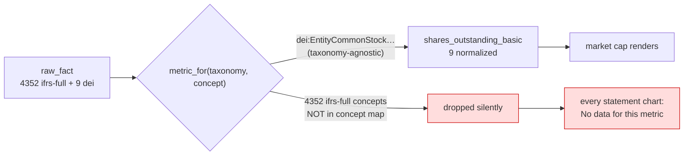
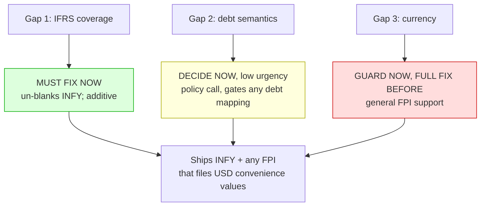
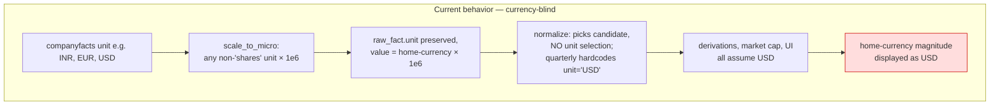
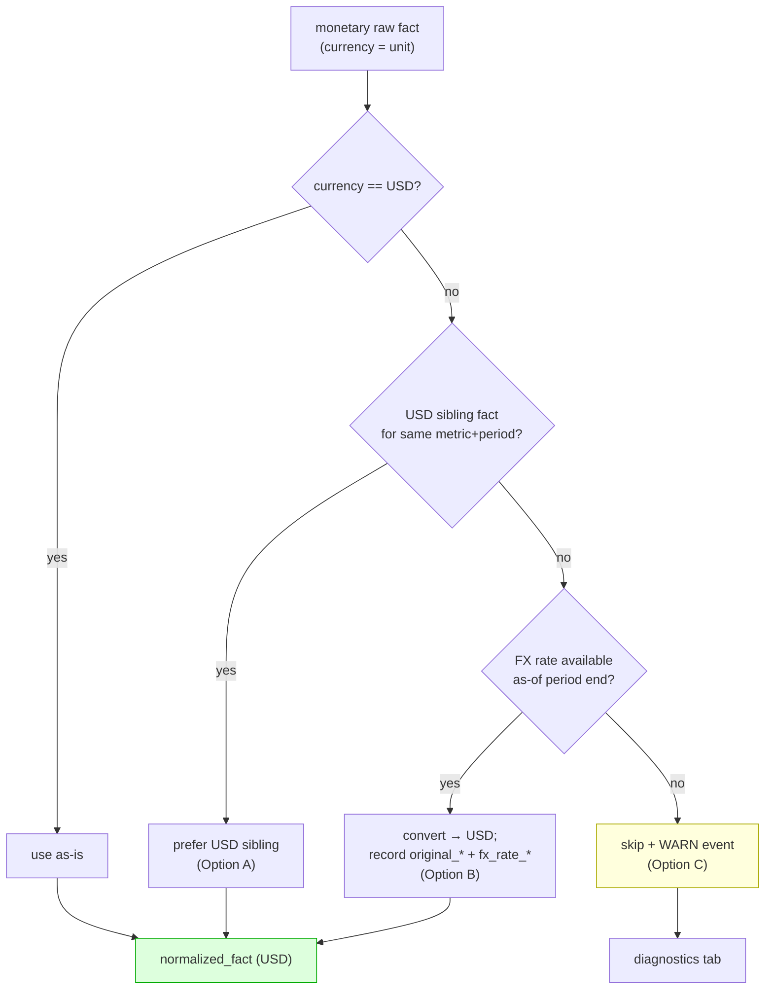
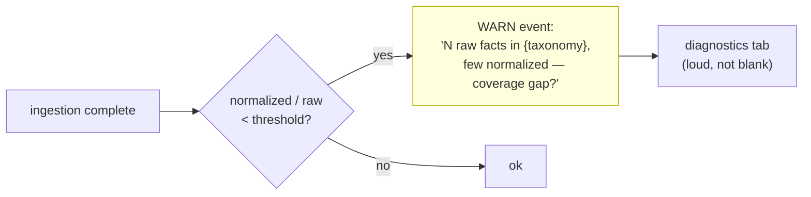

# DESIGN DOCUMENT

# IFRS TAXONOMY & CURRENCY-AWARE NORMALIZATION

**Status:** Proposed — awaiting sign-off on §5.2 (debt semantics) and §6 (currency scope)
**Companions:** `docs/ifrs-currency-support-techspec.md`
**Parent:** `docs/architecture.md`
**Trigger:** INFY (Infosys Ltd, CIK 0001067491) renders a blank dashboard — 4361 raw facts ingested, only 9 normalized.

---

## 1. Overview

Infosys files with the SEC as a **foreign private issuer**: its financial facts are tagged in the **`ifrs-full`** taxonomy, not `us-gaap`. Ingestion succeeds (748 filings, 4361 raw facts, 9 price points), but the normalization layer maps **only** `us-gaap` (51 curated concepts) plus a single `dei` concept. It contains **zero** `ifrs-full` mappings, so 4352 of 4353 IFRS facts are silently dropped. The one metric that survives — `shares_outstanding_basic` — comes through the taxonomy-agnostic `dei:EntityCommonStockSharesOutstanding` candidate, which is why market cap renders while every statement chart shows "No data for this metric."

Investigating the fix surfaced **three distinct gaps**. Only one is the blank screen; the other two are latent correctness risks that this document exists to separate, triage, and resolve durably.

The key structural finding: **the normalization engine is already taxonomy-agnostic.** `orchestrator.rs` calls `concept_map::metric_for(&f.taxonomy, &f.concept)` and normalizes whatever the table returns, with no `us-gaap` assumption anywhere on the path. IFRS produces nothing today for exactly one reason — the table has no IFRS rows. This is what makes Gap 1 additive rather than structural.

---

## 2. The three gaps

| # | Gap | Root cause | Blocks INFY? | Correctness risk if ignored |
|---|-----|-----------|--------------|-----------------------------|
| 1 | **IFRS concept coverage** (incl. concept drift across IFRS versions) | No `ifrs-full` rows in `concept_map.rs` | **Yes — this is the blank screen** | — |
| 2 | **Debt semantics under IFRS 16** | IFRS capitalizes all leases as `LeaseLiabilities`; issuer carries no traditional borrowings | No | Mapping leases → debt inflates leverage and breaks cross-taxonomy comparability |
| 3 | **Currency-blind pipeline** | `scale_to_micro` and the normalize path treat every monetary unit as USD | No — INFY files USD convenience translations | **High** — any FPI without USD convenience values yields silently wrong numbers labelled USD |

---

## 3. Triage — what must be fixed, and when

- **Gap 1 — must fix now.** This is the reported bug. The fix is additive (add `ifrs-full` candidates to the existing per-metric arms) and unblocks INFY plus every IFRS filer that provides USD convenience translations.
- **Gap 2 — decide now, implement cheaply.** Not a code-architecture problem; a product/domain policy. It does not block the dashboard (INFY is debt-free). But the policy **must be decided before any IFRS debt concept is mapped**, or we bake in a silent cross-taxonomy inconsistency.
- **Gap 3 — guard now, full fix before general FPI support.** INFY is saved only by luck: Infosys tags USD convenience values in its 20-F, which the pipeline scales correctly ($3.162B `ProfitLoss` FY25, $10.94B `Revenue` FY18 both verified accurate). The moment an issuer reports only in its home currency, today's pipeline stores home-currency magnitudes labelled USD — silently wrong. We add a **loud diagnostic now** (so this never manifests as a blank/garbage screen again) and schedule the FX-conversion fix as its own work package.

**Do not fix:** nothing here is a no-op. All three warrant action; they differ in urgency and altitude.

---

## 4. Gap 1 — IFRS concept coverage

### 4.1 What the data actually supports

I matched every internal metric against the `ifrs-full` concepts Infosys actually reports (counts are fact rows in the production DB). **14 of ~16 statement metrics have a clean, directly-mappable IFRS concept:**

| Internal metric | IFRS concept (fact count) | Note |
|---|---|---|
| Revenue | `RevenueFromContractsWithCustomers` (21), `Revenue` (3) | **concept drift** — modern IFRS 15 tag vs. legacy; needs both candidates |
| CostOfRevenue | `CostOfSales` (24) | clean |
| GrossProfit | `GrossProfit` (24) | clean |
| OperatingIncome | `ProfitLossFromOperatingActivities` (24) | clean — issuer *does* tag it |
| NetIncome | `ProfitLoss` (24) | clean |
| EpsBasic / EpsDiluted | `Basic/DilutedEarningsLossPerShare` (24) | clean, USD/shares |
| SharesOutstandingBasic | `WeightedAverageShares` (24) | clean |
| SharesOutstandingDiluted | `AdjustedWeightedAverageShares` (24) | naming: "adjusted" = diluted |
| CashAndEquivalents | `CashAndCashEquivalents` (28) | clean |
| TotalAssets / TotalLiabilities | `Assets` (16) / `Liabilities` (16) | clean |
| TotalEquity | `EquityAttributableToOwnersOfParent` (16), `Equity` (32) | parent-first, incl-NCI fallback (mirrors US-GAAP ordering) |
| CashFromOperations | `CashFlowsFromUsedInOperatingActivities` (24) | clean |
| CapitalExpenditures | `PurchaseOfPropertyPlantAndEquipmentClassifiedAsInvestingActivities` (9) | sign already normalized by `apply_sign` |
| DepreciationAmortization | `DepreciationAndAmortisationExpense` (24) | clean |
| PropertyPlantAndEquipmentNet | `PropertyPlantAndEquipment` (32) | clean |

The read-time derivations need **no change**: free cash flow (`ProfitLoss` + D&A − capex), the capex PP&E roll-forward fallback (`PropertyPlantAndEquipment` + D&A), and operating margin all resolve from the metrics above once the concepts are mapped.

### 4.2 Options

**Option A — inline `ifrs-full` candidates in the existing arms.** *(Recommended.)* Extend each `concepts_for` arm with its IFRS candidates after the `us-gaap` ones. Keeps a single source of truth per metric; the ordered-candidate mechanism already handles multi-taxonomy fallback; `metric_for` reverse lookup already iterates all candidates. ~20 concept lines.

**Option B — externalize the map to a data file (TOML/CSV) loaded at startup.** More scalable for many taxonomies, but introduces a load path, a parse-error surface, and drift between file and `Metric` enum. Not justified at two taxonomies.

**Concept drift within a taxonomy** (e.g. IFRS 15 changed `Revenue` → `RevenueFromContractsWithCustomers`) is handled by the **same ordered-candidate list** we already use for US-GAAP synonyms — no new mechanism.

### 4.3 Recommendation

Option A, plus two **forward-looking guards** (§7) so a future metric can't silently regress IFRS coverage and so a coverage collapse never again surfaces as a blank screen.

---

## 5. Gap 2 — debt semantics under IFRS 16

### 5.1 The problem

Under **IFRS 16** every lease is capitalized as a `LeaseLiabilities` line. Infosys carries essentially no financial borrowings (`Borrowings`: 1 fact) — its balance-sheet "debt" is almost entirely lease liabilities (22 facts). Under **US-GAAP (ASC 842)** operating-lease liabilities are also on-balance-sheet, but our `us-gaap` map deliberately routes them to **neither** `LongTermDebt` **nor** `CurrentDebt` — only interest-bearing borrowings count as debt.

If we map IFRS `LeaseLiabilities` → debt, an IFRS filer's leverage would include operating leases that an otherwise-identical US filer's would exclude. That is a **cross-taxonomy comparability defect**: the same metric would mean two different economic things depending on where the company files.

### 5.2 The governing principle & options

> **Economic-equivalence rule:** a metric means the same economic thing regardless of taxonomy. An IFRS concept may be mapped to a metric only if it is economically equivalent to that metric's US-GAAP concept — not merely "close."

**Option A — map interest-bearing borrowings only; exclude leases.** *(Recommended.)* `LongTermDebt` ← `NoncurrentBorrowings` / `Borrowings`; `CurrentDebt` ← `CurrentBorrowings`. Leases are excluded, exactly as for US-GAAP. Preserves comparability. For Infosys this yields ~zero debt — which is *correct*.

**Option B — count leases as debt on both sides.** Consistent across taxonomies, but changes existing US-GAAP numbers (larger blast radius), and conflicts with how most screeners report "debt." Rejected as default.

**Option C — introduce a distinct `LeaseLiabilities` metric.** Cleanest long-term: surface leases explicitly rather than forcing them into "debt." Deferred — adds a metric and UI surface; not required to render INFY correctly.

### 5.3 Recommendation

Adopt the economic-equivalence rule as written policy. Implement **Option A** now. Keep **Option C** on the roadmap for when lease disclosure becomes a product requirement. This is the one item that needs an explicit product **sign-off** before the debt concepts are mapped.

---

## 6. Gap 3 — currency-aware normalization (the architectural core)

### 6.1 Why today's pipeline is currency-blind

Three concrete facts from the code:
- `scale_to_micro` (`companyfacts.rs:118`) multiplies **any** unit except `shares` by 10⁶ — it never inspects the currency.
- The normalize path (`orchestrator.rs`) selects candidates and best-per-period **without ever filtering on unit**; the quarterly branch hardcodes `unit: "USD"` (line 185); the annual/instant branches preserve `f.unit` but everything downstream assumes USD.
- `normalized_fact` already has `fx_rate_micro`, `fx_rate_source`, `fx_rate_date`, `original_value`, `original_unit` columns and there is an `fx_rate` table — **the FX scaffolding exists but is wired to `None` everywhere.**

INFY escapes this only because Infosys files USD convenience translations (4032 of its facts are USD). A pure-INR filer would flow home-currency magnitudes straight through as "USD."

The `require_usd` guard on the **market-data** adapter (`market_data.rs:106`) already embodies the correct principle for quotes — *reject rather than mislabel*. Statement facts have no equivalent guard. The fix extends that principle to the fact pipeline.

### 6.2 Options

**Option A — USD-preference candidate selection.** When a concept is tagged in multiple currencies for a period, prefer the USD-unit fact and drop non-USD when a USD sibling exists. Cheap; fully fixes convenience-translation filers (INFY) and prevents accidental home-currency pickup. **Does not** help pure-foreign-currency filers.

**Option B — FX conversion at normalization.** *(The durable fix.)* For a monetary fact whose currency ≠ USD, convert to USD using an FX rate as-of the period end, store the converted value, and record provenance in the **existing** columns (`original_value`, `original_unit`, `fx_rate_micro`, `fx_rate_source`, `fx_rate_date`). Requires an `FxRateSource` and populating the `fx_rate` table.

**Option C — reject + diagnostic.** If a monetary fact is non-USD and cannot be converted, **skip it and emit a WARN ingestion event** rather than store a mislabelled number. This is the accuracy-preserving floor and aligns with the project's hard-accuracy rule.

### 6.3 Recommended architecture — a layered currency-resolution stage

Introduce an explicit **currency-resolution step** between raw-fact selection and normalized-fact persistence, applying a strict ladder per monetary fact:

Supporting structural changes:
1. **Treat currency as first-class.** `raw_fact.unit` already carries it; stop assuming USD downstream. The quarterly branch must stop hardcoding `unit: "USD"` and instead flow the resolved currency.
2. **Split `scale_to_micro`'s two responsibilities** — "is this monetary?" (scale ×10⁶) vs. "which currency is it?" (drives resolution). Scaling stays; currency detection becomes explicit.
3. **`FxRateSource` trait** feeding the `fx_rate` table, mirroring the existing `MarketDataSource` adapter shape. Rate keyed by (currency, date); resolution uses the period-end date.
4. **Provenance is mandatory** whenever a value is FX-converted: the converted USD value is the fact; `original_value`/`original_unit`/`fx_rate_*` record how we got there, upholding the product's auditability principle.

### 6.4 Recommendation

Ship **Option A + Option C now** (they are cheap, and together they make the pipeline *honest* — correct for convenience-translation filers, loud-and-safe for everyone else). Ship **Option B** as the follow-on work package that unlocks general FPI support. Sequencing and the FX-source choice are in the tech spec.

---

## 7. Forward-looking guards — stop silent recurrence

The deeper defect behind all three gaps is **silence**: 4352 dropped facts produced a blank screen with no error. These guards convert each failure mode into a loud, testable signal.

| Guard | Prevents | Mechanism |
|---|---|---|
| **Coverage-matrix test** | Gap 1 regressions | Unit test over `Metric::ALL`: any metric with `us-gaap` candidates must also declare `ifrs-full` candidates (or be explicitly annotated US-only, e.g. bank concepts). Fails CI when a new metric forgets IFRS. |
| **Raw-to-normalized ratio diagnostic** | Gaps 1 & 3 in the wild | At end of ingestion, if `normalized_facts / raw_facts` falls below a threshold (e.g. the 9/4361 seen here), emit a **WARN** ingestion event naming the dominant unmapped taxonomy. The blank screen becomes a visible diagnostic. |
| **Economic-equivalence review checklist** | Gap 2 | Documented rule (§5.2) + a checklist item on any concept-map change: "is this IFRS concept economically equal to the US-GAAP concept for this metric?" |
| **Currency provenance assertion** | Gap 3 | Test: no `normalized_fact` may carry a non-USD `unit`; any FX-converted fact must have non-null `original_unit` + `fx_rate_*`. |

---

## 8. Decision summary

| Gap | Verdict | Chosen approach | Needs sign-off? |
|---|---|---|---|
| 1 — IFRS coverage | **Fix now** | Inline `ifrs-full` candidates (Opt A) + coverage-matrix test | No |
| 2 — Debt semantics | **Decide now, implement cheaply** | Economic-equivalence rule; borrowings-only, exclude leases (Opt A); `LeaseLiabilities` metric deferred (Opt C) | **Yes — product sign-off on treatment of leases as non-debt** |
| 3 — Currency | **Guard now, full fix scheduled** | USD-preference + reject/diagnostic now (Opts A+C); FX conversion via `FxRateSource` next (Opt B) | Scope confirmation on whether Opt B is in this cycle |
| Cross-cutting | **Fix now** | Four guards in §7 | No |

The blank screen closes with Gap 1 alone. Gaps 2 and 3 are the difference between "INFY works" and "IFRS filers work correctly and safely in general" — this document recommends fixing Gap 1 immediately, deciding Gap 2's policy before mapping any debt concept, and landing Gap 3's guards now with its FX conversion as the next scheduled unit of work.
