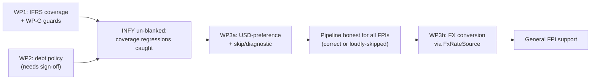

# TECHNICAL SPECIFICATION

# IFRS TAXONOMY & CURRENCY-AWARE NORMALIZATION

**Status:** Proposed
**Companions:** `docs/ifrs-currency-support-design.md`
**Parent:** `docs/architecture.md`, `docs/tech_spec.md`
**Audience:** Implementing engineers / agents

---

## 1. Scope

Three work packages, independently shippable in order:

- **WP1 — IFRS concept coverage** (closes the INFY blank screen; additive).
- **WP2 — debt semantics policy** (IFRS 16; gated on product sign-off).
- **WP3 — currency-aware normalization** (WP3a guards now; WP3b FX conversion next).

Plus cross-cutting **guards** (WP-G) that ship with WP1.

Nothing here changes the read-time derivation model, the period reconciler, or the IPC surface. The normalization engine is already taxonomy-agnostic (`orchestrator.rs` → `concept_map::metric_for(&f.taxonomy, &f.concept)`), so WP1 is pure data addition to one file.

---

## 2. WP1 — IFRS concept coverage

### 2.1 Concept-map additions — `src-tauri/src/normalize/concept_map.rs`

Extend each `concepts_for(metric)` arm by appending `ifrs-full` candidates **after** the existing `us-gaap` (and `dei`) candidates. Ordering matters: US-GAAP first preserves current behavior for US filers; IFRS candidates are fallbacks that only fire for IFRS filers. Within IFRS, list the modern (IFRS 15/16-era) concept before the legacy one.

| `Metric` arm | Append these `("ifrs-full", …)` candidates (in order) |
|---|---|
| `Revenue` | `RevenueFromContractsWithCustomers`, `Revenue` |
| `CostOfRevenue` | `CostOfSales` |
| `GrossProfit` | `GrossProfit` |
| `OperatingIncome` | `ProfitLossFromOperatingActivities` |
| `NetIncome` | `ProfitLoss` |
| `EpsBasic` | `BasicEarningsLossPerShare` |
| `EpsDiluted` | `DilutedEarningsLossPerShare` |
| `SharesOutstandingBasic` | `WeightedAverageShares` |
| `SharesOutstandingDiluted` | `AdjustedWeightedAverageShares` |
| `CashAndEquivalents` | `CashAndCashEquivalents` |
| `TotalAssets` | `Assets` |
| `TotalLiabilities` | `Liabilities` |
| `TotalEquity` | `EquityAttributableToOwnersOfParent`, `Equity` |
| `CashFromOperations` | `CashFlowsFromUsedInOperatingActivities` |
| `CapitalExpenditures` | `PurchaseOfPropertyPlantAndEquipmentClassifiedAsInvestingActivities` |
| `DepreciationAmortization` | `DepreciationAndAmortisationExpense` |
| `PropertyPlantAndEquipmentNet` | `PropertyPlantAndEquipment` |
| `LongTermDebt` / `CurrentDebt` | **See WP2 — do not map until policy is signed off** |

Notes:
- `TotalEquity`: parent-attributable first, incl-NCI (`Equity`) fallback — mirrors the existing US-GAAP ordering (`StockholdersEquity` before the incl-NCI variant).
- `CapitalExpenditures`: `apply_sign` already `abs()`-normalizes this metric (`orchestrator.rs:430`), so the IFRS investing-outflow sign needs no special handling.
- Bank metrics (`NetInterestIncome`, `NoninterestIncome`, `InterestIncomeOperating`, `InterestExpense`) stay US-GAAP-only; annotate them explicitly for the coverage test (§5.1).
- No change to `metric_for` — it already iterates every candidate across all taxonomies.

### 2.2 Derivations — no change required

`free_cash_flow` (= `NetIncome` + `DepreciationAmortization` − `CapitalExpenditures`), the capex PP&E roll-forward fallback (`PropertyPlantAndEquipmentNet` + `DepreciationAmortization`), `operating_margin`, and the TTM/yield chain all resolve once the §2.1 metrics are populated. Verified against INFY's reported facts: every input concept is present.

### 2.3 Acceptance

INFY (CIK 0001067491) renders non-empty Income / Balance / Cashflow / Valuation series. Re-ingest, then confirm `normalized_fact` count for the CIK jumps from 9 to the expected multi-metric set.

---

## 3. WP2 — debt semantics (IFRS 16)

**Gated on product sign-off** (design §5.3). Policy: **economic equivalence** — map interest-bearing borrowings only; exclude lease liabilities, matching the US-GAAP treatment.

Once approved, append to the debt arms:

| `Metric` arm | Append `("ifrs-full", …)` |
|---|---|
| `LongTermDebt` | `NoncurrentBorrowings`, `Borrowings` |
| `CurrentDebt` | `CurrentBorrowings` |

Do **not** map `LeaseLiabilities` / `NoncurrentLeaseLiabilities` / `CurrentLeaseLiabilities` to any debt metric. For Infosys this correctly yields ~zero debt (`Borrowings`: 1 fact; no material borrowings). A distinct `LeaseLiabilities` metric is deferred (design §5.2 Option C).

---

## 4. WP3 — currency-aware normalization

### 4.1 WP3a — guards now (cheap, honest)

**Split currency detection from scaling — `src-tauri/src/sources/companyfacts.rs`:**

```rust
/// Monetary units are scaled ×1e6; `shares` ×1; the currency (if any) is
/// returned separately so downstream can resolve it to USD.
fn classify_unit(unit: &str) -> UnitClass {
    match unit {
        "shares"           => UnitClass::Count,
        "pure"             => UnitClass::Ratio,          // ×1e6, no currency
        u if u.contains('/') => UnitClass::PerShare(currency_of(u)), // e.g. USD/shares, INR/shares
        u                  => UnitClass::Monetary(currency_of(u)),   // USD, INR, EUR, …
    }
}
```

`scale_to_micro` keeps its ×1e6 / ×1 behavior; it stops being the place that implicitly declares "everything is USD."

**USD-preference selection + reject/diagnostic — `src-tauri/src/pipeline/orchestrator.rs`:**

In `best_annual` / `best_instant` selection and in the quarterly path, when the winning fact's currency ≠ USD:
1. If a USD-unit sibling fact exists for the same (metric, period), prefer it (Option A).
2. Else skip the fact and emit a `Severity::Warn` ingestion event (Option C): *"Skipped {metric} for FY{y}: reported in {ccy}, USD conversion not yet available."*

Stop hardcoding `unit: "USD"` in the quarterly branch (`orchestrator.rs:185`); flow the resolved currency (which, after this ladder, is always USD or the fact is skipped).

### 4.2 WP3b — FX conversion (unlocks general FPI support)

**New source — `src-tauri/src/sources/fx.rs`:**

```rust
#[async_trait]
pub trait FxRateSource: Send + Sync {
    /// USD per 1 unit of `currency`, as micro-units (rate × 1e6), on/at `date`.
    async fn rate_to_usd(&self, currency: &str, date: NaiveDate)
        -> Result<Option<i64>, SourceError>;
}
```

Rates are cached in the existing **`fx_rate`** table (already in the schema). Resolution uses the fact's **period-end** date. Mirror the `MarketDataSource` adapter shape and its `require_usd`-style honesty (never fabricate a rate).

**Conversion in normalization:** when a monetary fact's currency ≠ USD and no USD sibling exists, convert and record provenance in the columns that already exist on `normalized_fact`:

```rust
NormalizedFact {
    value:        usd_micro,            // converted
    unit:         "USD".into(),
    original_value: Some(home_micro),
    original_unit:  Some(currency),     // e.g. "INR"
    fx_rate_micro:  Some(rate_micro),
    fx_rate_source: Some(source_tag),
    fx_rate_date:   Some(period_end),
    ..
}
```

Only if `rate_to_usd` returns `None` do we fall through to the WP3a skip+diagnostic.

### 4.3 Read/UI

No IPC or UI contract change: normalized facts remain USD micro-units. The diagnostics tab already surfaces ingestion events, so WP3a skips appear there automatically.

---

## 5. WP-G — guards (ship with WP1)

### 5.1 Coverage-matrix test — `concept_map.rs` `#[cfg(test)]`

```rust
/// Every metric that has us-gaap candidates must also declare ifrs-full
/// candidates, unless explicitly allow-listed as US-only (bank concepts).
#[test]
fn ifrs_coverage_matches_us_gaap() {
    const US_ONLY: &[Metric] = &[
        Metric::NetInterestIncome, Metric::NoninterestIncome,
        Metric::InterestIncomeOperating, Metric::InterestExpense,
    ];
    for m in Metric::ALL {
        let cands = concepts_for(*m);
        let has_us   = cands.iter().any(|(t, _)| *t == "us-gaap");
        let has_ifrs = cands.iter().any(|(t, _)| *t == "ifrs-full");
        if has_us && !US_ONLY.contains(m) {
            assert!(has_ifrs, "metric {:?} has us-gaap but no ifrs-full candidate", m);
        }
    }
}
```

### 5.2 Raw-to-normalized ratio diagnostic — `orchestrator.rs`

After normalization completes, before returning, compute coverage per taxonomy and emit a WARN when a taxonomy contributes many raw facts but few normalized ones:

```rust
// Pseudocode — thresholds tunable; the 9/4361 INFY case must trip this.
for (taxonomy, raw_n) in raw_counts_by_taxonomy {
    let norm_n = normalized_from_taxonomy(taxonomy);
    if raw_n >= 200 && (norm_n as f64) < 0.02 * raw_n as f64 {
        record_event(deps, &cik, None, "normalize", Severity::Warn, false,
            format!("{raw_n} raw facts in `{taxonomy}` but only {norm_n} normalized — \
                     likely a concept-map coverage gap.", ),
            &mut events).await?;
    }
}
```

This converts the silent blank screen into a visible diagnostic on the very ingestion that would otherwise fail quietly.

### 5.3 Currency provenance assertion — normalize integration test

```rust
// No normalized fact may carry a non-USD unit. Any FX-converted fact must
// carry full provenance.
assert!(nf.unit == "USD");
if nf.original_unit.is_some() {
    assert!(nf.fx_rate_micro.is_some() && nf.fx_rate_date.is_some());
}
```

---

## 6. File-level change table

| File | WP | Change |
|---|---|---|
| `src-tauri/src/normalize/concept_map.rs` | WP1 | Append `ifrs-full` candidates to arms per §2.1; add coverage-matrix test |
| `src-tauri/src/normalize/concept_map.rs` | WP2 | Append borrowings candidates to `LongTermDebt`/`CurrentDebt` (post sign-off) |
| `src-tauri/src/sources/companyfacts.rs` | WP3a | `classify_unit` / `currency_of`; keep `scale_to_micro` scaling-only |
| `src-tauri/src/pipeline/orchestrator.rs` | WP3a | USD-preference selection; skip+WARN for non-USD; stop hardcoding `unit:"USD"` in quarterly branch |
| `src-tauri/src/pipeline/orchestrator.rs` | WP-G | Raw-to-normalized ratio diagnostic (§5.2) |
| `src-tauri/src/sources/fx.rs` | WP3b | **New** — `FxRateSource` trait + adapter |
| `src-tauri/src/sources/mod.rs` | WP3b | `pub mod fx;` |
| `src-tauri/src/repos/fx_rate.rs` | WP3b | Read/write cache over the existing `fx_rate` table (if not already present) |
| `src-tauri/src/pipeline/orchestrator.rs` | WP3b | Wire FX conversion + provenance into normalize; `IngestionDeps.fx` |
| `src-tauri/src/ipc/state.rs` | WP3b | Construct/inject the FX source |
| `src-tauri/tests/*` | WP3b | Construct `fx` in `IngestionDeps`; provenance assertion (§5.3) |

No TypeScript changes for any WP (wire contract is unchanged — still USD micro-units).

---

## 7. Testing

### 7.1 WP1
- `ifrs_coverage_matches_us_gaap` test green.
- Offline accuracy test against the production DB fixture: re-normalize CIK `0001067491`; assert non-empty series for `revenue`, `net_income`, `operating_income`, `total_assets`, `total_equity`, `cash_from_operations`, `free_cash_flow`. Spot-check magnitudes (e.g. `net_income` FY2025 ≈ $3.162B, `revenue` FY2018 ≈ $10.94B).
- `cargo test` green.

### 7.2 WP2
- After mapping, INFY `long_term_debt` + `current_debt` ≈ 0 (no material borrowings); assert `LeaseLiabilities` is **not** picked up by either debt metric.

### 7.3 WP3
- WP3a: a synthetic fixture with an INR-only monetary fact and no USD sibling produces a WARN event and no normalized fact for that metric.
- WP3a: a fact with both USD and INR siblings normalizes from the USD one.
- WP3b: the same INR-only fact normalizes to USD with populated `original_*` + `fx_rate_*`; provenance assertion (§5.3) green.

### 7.4 Guards
- Ratio diagnostic: re-run the pre-WP1 concept map (or a metric-stripped fixture) over INFY and assert the WARN fires; confirm it does **not** fire for a well-covered US filer.

---

## 8. Sequencing



WP1 + WP-G is the minimum to close the reported bug safely. WP2 is a one-line-per-arm change once the lease policy is signed off. WP3a makes the pipeline honest for every foreign filer at low cost; WP3b is the larger, self-contained follow-on that unlocks issuers with no USD convenience translation.
