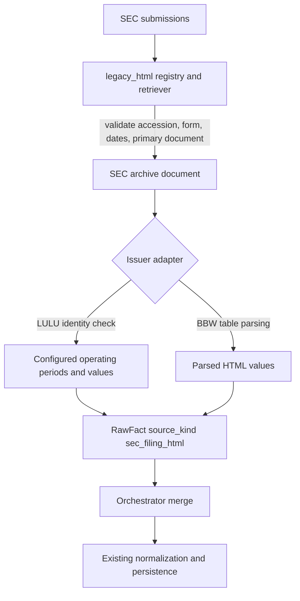
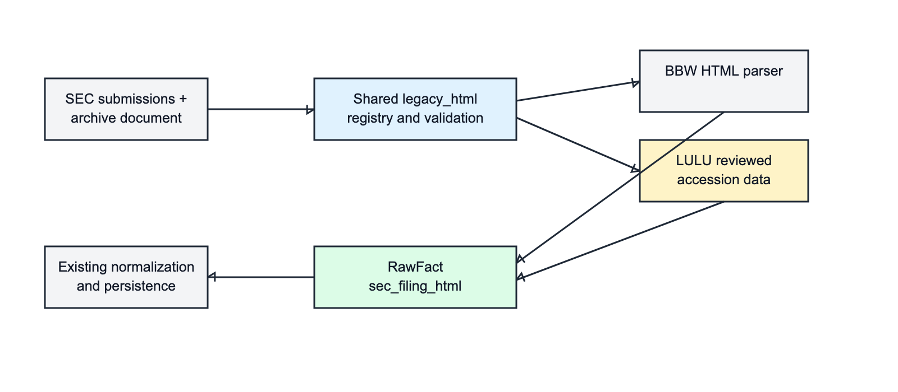
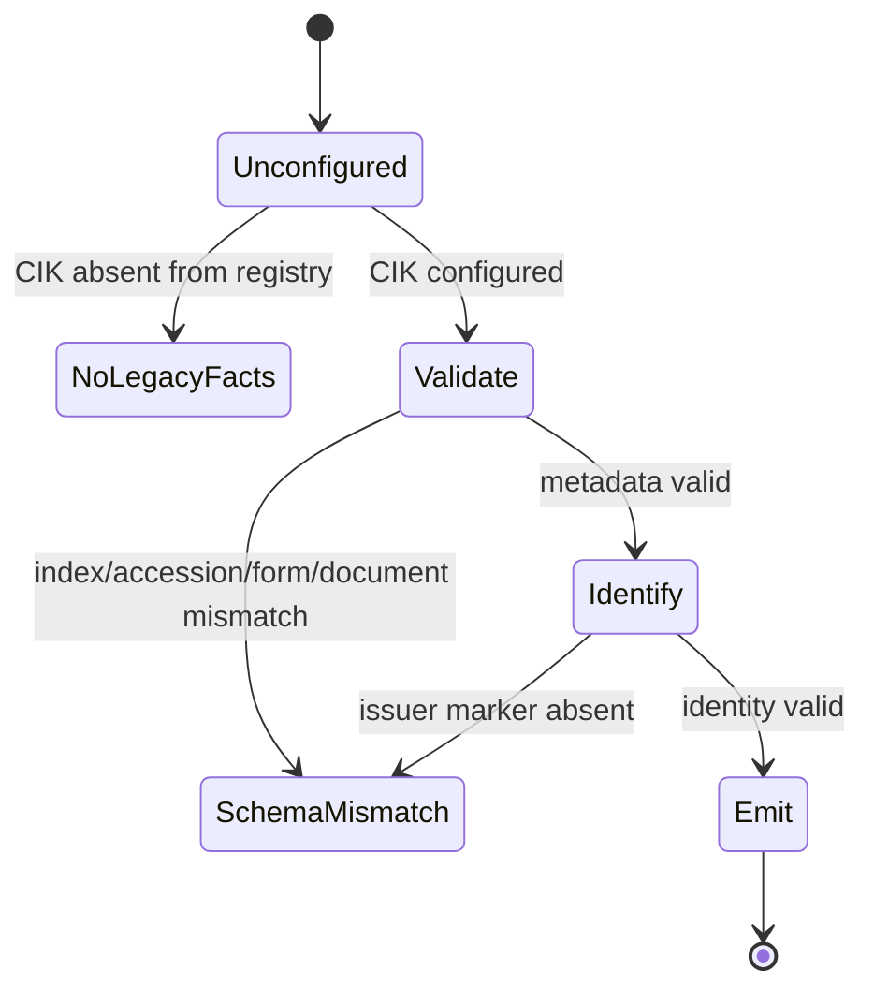

# Legacy SEC History: Design

## Overview

The implementation separates reusable SEC document acquisition from issuer-specific interpretation. `legacy_html` owns the registry, historical-submissions lookup, metadata validation, archive download, common fact construction, and parser utilities. Each adapter supplies a CIK, historical anchor, expected accession/form list, and parse function. The orchestrator merges returned facts with Company Facts before the existing persistence and normalization stages.

## Components

| Component | Responsibility |
|---|---|
| `IssuerConfig` | Binds CIK, historical anchor, expected filings, and parser. |
| `FilingConfig` | Pins one accession to an expected SEC form. |
| `fetch_configured_history` | Finds the covering historical index, validates filing metadata, downloads each indexed primary document, and invokes the adapter. |
| Shared helpers | Normalize HTML text, locate tables/amounts, scale thousands, construct dates, and emit lineage-bearing `RawFact`s. |
| LULU adapter | Validates document identity and maps accession-pinned operating schedules to three concepts. |
| Orchestrator | Upserts legacy filings, appends raw facts, and records retrieval count before standard normalization. |

## LULU Data Model And Coverage

Each `OperatingPeriod` stores start date, end date, fiscal-period tag, and reviewed values in USD thousands. Emission maps the fields to `Revenues`, `CostOfGoodsSold`, and `NetIncomeLoss`, multiplies by `1,000 * MICRO`, and records `SourceKind::SecFilingHtml`.

Annual end dates are exactly: `2004-01-31`, `2005-01-31`, `2006-01-31`, `2007-01-31`, `2008-02-03`, `2009-02-01`, `2010-01-31`.

Quarterly coverage is exactly 16 period ends from `2006-04-30` through `2010-01-31`: four quarters for each fiscal year FY2006 through FY2009. All stated dates carry Revenues, COGS, and NetIncome. No broader legacy coverage is implied.

## Provenance And Trust Model

The framework uses two checks before trusting an adapter result:

1. **Metadata validation:** the configured accession must appear in the SEC-provided historical submissions file, its form must match, its dates must parse, and the index must identify a primary document.
2. **Document identity validation:** the downloaded LULU document must contain the issuer marker `lululemon`.

Only then does the adapter emit values configured for that exact accession. Facts retain the SEC accession and downloaded-document lineage even though LULU's numeric cells are not parsed at runtime.

### Pinned Accession/Value Tradeoff

Pinning values gives deterministic results, explicit review surfaces, and immunity to fragile legacy table markup. The cost is that the system verifies document identity, not each configured number against the live HTML on every run. This is acceptable only because the value set is small, tests lock boundaries and representative amounts, and any accession change is fail-closed and requires deliberate review. It must not be described as generic extraction.

## Historical Interpretation

FY2003 and FY2004 are the annual periods ending `2004-01-31` and `2005-01-31`. Their values are selected comparative operating data presented by the later 2008 10-K accession `0000909567-08-000415`. The lineage means "reported in this later SEC document," not "filed as a standalone SEC report for that fiscal year." The design makes no pre-IPO availability, contemporaneous disclosure, or post-IPO status claim for either period.

## Failure Behavior

The adapter never falls back to guessed accessions, alternate forms, approximate dates, or inferred values. A mismatch aborts ingestion with `SourceError::SchemaMismatch`; unconfigured issuers simply receive no supplemental facts.

## Requirements And Non-Goals

- Required: exact period boundaries, all three LULU metrics, accession lineage, USD micro-unit scaling, existing normalization behavior, and fail-closed validation.
- Not included: generic OCR/table extraction, amendment resolution, automatic schedule refresh, estimates, periods before `2004-01-31` annually or `2006-04-30` quarterly, and pre-IPO reporting claims.

## Testing Strategy

- Shared unit tests cover registry routing, archive URL canonicalization, amount parsing, and scaling.
- LULU unit tests cover annual and quarterly boundaries, representative configured values, period starts/tags, fact count, HTML provenance, and fail-closed identity and unknown-accession gates.
- The ignored live LULU integration test covers SEC retrieval plus full pipeline behavior: earliest dates, annual continuity, and quarterly ordering.
