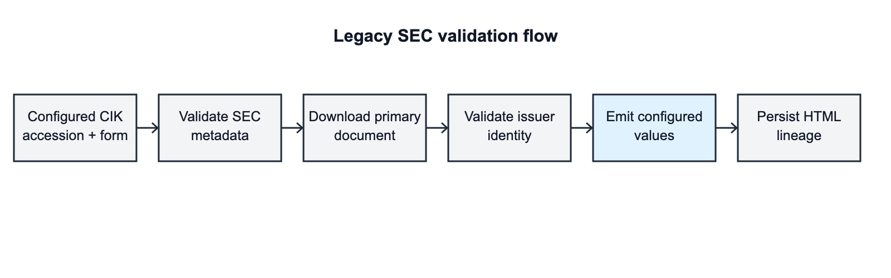

# Legacy SEC History: Product Requirements

## Problem

SEC Company Facts does not provide complete structured history for some pre-XBRL periods. The implemented legacy framework supplements that gap from configured public SEC filings without weakening lineage: only explicitly supported issuers and accessions participate. The first adapter extends LULU operating history with `Revenues`, `CostOfGoodsSold` (COGS), and `NetIncomeLoss` (NetIncome).

## Goals

- Reuse one SEC retrieval, metadata-validation, lineage, and persistence path for issuer-specific legacy adapters.
- Provide exact LULU annual period-end coverage from `2004-01-31` through `2010-01-31` and quarterly period-end coverage from `2006-04-30` through `2010-01-31` for Revenues, COGS, and NetIncome.
- Preserve SEC filing accession, filing date, period boundaries, USD units, micro-unit scaling, and `sec_filing_html` provenance on every emitted fact.
- Fail closed when SEC metadata, form, accession, primary-document availability, or document identity does not match configuration.

## Non-Goals

- Generic extraction from arbitrary pre-XBRL HTML.
- Automatic discovery of issuers, filings, concepts, or values.
- Filling periods outside the exact configured ranges or estimating missing values.
- Representing the earliest LULU values as contemporaneous standalone filings or making pre-IPO public-reporting claims.

## Requirements

1. Unconfigured CIKs produce no legacy facts and continue through normal ingestion unchanged.
2. Configured accessions must exist in the SEC historical submissions index with the expected form and a primary document.
3. The downloaded LULU primary document must contain the configured issuer identity marker before any facts are emitted.
4. Configured values must remain tied to the accession whose annual-report operating-data schedule presents them; changing an accession must require review of its values and period map.
5. LULU must emit three facts per configured period: `Revenues`, `CostOfGoodsSold`, and `NetIncomeLoss`, in USD and scaled to the application's micro-unit representation.
6. Annual end dates must be exactly `2004-01-31`, `2005-01-31`, `2006-01-31`, `2007-01-31`, `2008-02-03`, `2009-02-01`, and `2010-01-31`.
7. Quarterly end dates must begin `2006-04-30`, continue as the 16 configured consecutive fiscal quarters, and end `2010-01-31`.
8. Legacy filings and facts must enter the existing normalization, persistence, lineage, and ingestion-event paths.

## Provenance And Trust

The source is the SEC-hosted primary document identified through SEC historical submissions metadata. Trust is layered rather than inferred from a URL alone:

The LULU adapter intentionally pins reviewed values to accessions. This is more deterministic than runtime table scraping and resists harmless HTML-layout drift, but it does not independently re-extract each number on every ingestion. Metadata plus document identity validation establishes that the expected SEC document was retrieved; code review and tests establish that configured values and periods remain associated with that accession. A filing replacement therefore fails or requires a deliberate configuration update rather than silently accepting new content.

## FY2003/FY2004 Status

The annual periods ending `2004-01-31` and `2005-01-31` correspond to LULU FY2003 and FY2004 operating results. They are comparative **selected-data history presented in the later accession `0000909567-08-000415`**, not claims that LULU filed standalone FY2003 or FY2004 SEC annual reports. LULU's IPO occurred later; this feature makes no claim that these periods were publicly filed at the time, were post-IPO, or had the same reporting context as post-IPO periods.

## Acceptance And Tests

- Unit tests verify configured-CIK routing, archive URL construction, shared amount scaling, first/last annual values, first/last quarterly values, period starts, fiscal-period tags, fact counts, `SecFilingHtml` provenance, document identity rejection, and unknown-accession rejection.
- The ignored live integration test ingests LULU from SEC EDGAR, requires annual history to begin `2004-01-31` without interior fiscal-year gaps, and requires quarterly history to begin `2006-04-30` in end-date order.
- Acceptance requires all three metrics at every stated annual and quarterly end date, with no implied coverage before those boundaries.

## Success Criteria

- LULU charts and statements expose the exact configured ranges after normal ingestion.
- Every added point resolves to a configured SEC accession in lineage.
- SEC or configuration drift produces a schema-mismatch failure, not unverified data.
