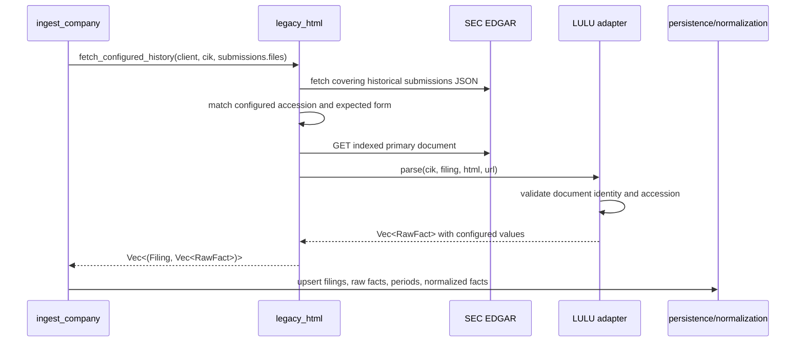
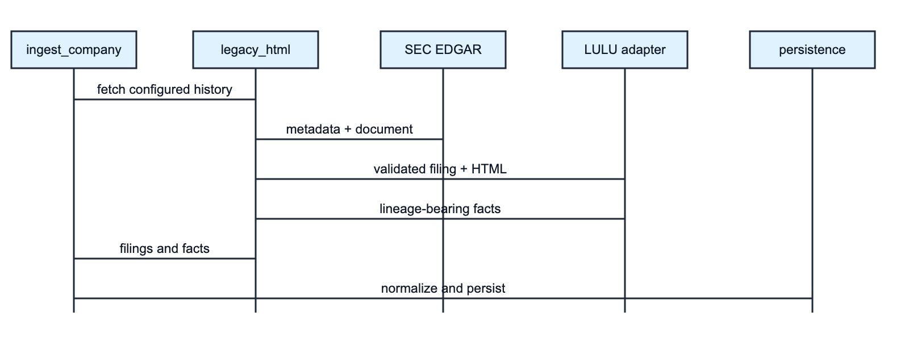

# Legacy SEC History: Technical Specification

## Scope

This specification records the implemented shared pre-XBRL SEC framework and LULU historical operating-data adapter. It adds configured `RawFact`s to the existing ingestion pipeline; it does not change schemas or public APIs.

## Interfaces And Flow





Core internal contracts:

```rust
type ParseFn = fn(&Cik, &Filing, &str, &str) -> Result<Vec<RawFact>, SourceError>;

async fn fetch_configured_history(
    client: &SecClient,
    cik: &Cik,
    files: &[HistoricalSubmissionsFile],
) -> Result<Vec<(Filing, Vec<RawFact>)>, SourceError>;
```

`IssuerConfig` contains `cik`, `historical_anchor`, `filings`, and `parse`. `FilingConfig` contains the accession and expected `FormType`. LULU is registered as CIK `0001397187` with 10-K accessions `0000909567-08-000415`, `0000909567-09-000292`, and `0000950123-10-028033`.

## Requirements

| ID | Requirement |
|---|---|
| LH-1 | Return an empty result for unregistered CIKs. |
| LH-2 | Select an SEC historical submissions file covering the issuer anchor date. |
| LH-3 | Require each configured accession, expected form, valid filing/report dates, and indexed primary document. |
| LH-4 | Build the SEC archive URL from unpadded CIK, hyphenless accession, and SEC-indexed primary-document name. |
| LH-5 | Require LULU document identity marker and reject unknown accessions. |
| LH-6 | Emit Revenues, COGS, and NetIncome for every configured LULU period as USD micro-units with `sec_filing_html` provenance. |
| LH-7 | Preserve accession, filing date, period start/end, and FY/Q1-Q4 tag through normal ingestion. |
| LH-8 | Fail with schema mismatch rather than substitute a document, date, or value. |

## Exact LULU Coverage

| Kind | Exact end dates | Metrics at every end date |
|---|---|---|
| Annual | `2004-01-31`, `2005-01-31`, `2006-01-31`, `2007-01-31`, `2008-02-03`, `2009-02-01`, `2010-01-31` | Revenues, COGS, NetIncome |
| Quarterly | `2006-04-30`, `2006-07-31`, `2006-10-31`, `2007-01-31`, `2007-04-30`, `2007-07-31`, `2007-10-31`, `2008-02-03`, `2008-05-04`, `2008-08-03`, `2008-11-02`, `2009-02-01`, `2009-05-03`, `2009-08-02`, `2009-11-01`, `2010-01-31` | Revenues, COGS, NetIncome |

Concept mapping is `Revenues`, `CostOfGoodsSold`, and `NetIncomeLoss`. Configured source amounts are USD thousands and become `amount * 1_000 * MICRO`. Duration facts always include explicit starts; annual facts use `FY`, and quarterly facts use `Q1` through `Q4`.

## Provenance, Validation, And Tradeoff

The SEC historical submissions response supplies the filing record and primary-document identity. The framework validates accession, expected form, parseable dates, and primary-document presence before download. The LULU parser then validates that the downloaded document identifies lululemon and dispatches only on one of the three configured accessions.

Values are statically configured and tied to the accession whose annual-report schedule presents them. This avoids brittle runtime parsing of old HTML but means metadata and document identity are live-validated while individual values are protected by configuration review and tests. A changed or missing accession cannot inherit the old values. This trust boundary must remain visible in documentation and lineage.

FY2003 (`2004-01-31`) and FY2004 (`2005-01-31`) are selected-data comparatives carried in accession `0000909567-08-000415`. They are not standalone FY2003/FY2004 SEC filings, and neither the adapter nor UI should imply contemporaneous filing, post-IPO status, or any pre-IPO public-reporting claim.

## File-Level Change Table

| File | Implemented responsibility |
|---|---|
| `src-tauri/src/sources/legacy_html/mod.rs` | Shared registry, SEC historical lookup, filing/document validation, archive retrieval, parsing/scaling helpers, and `RawFact` construction. |
| `src-tauri/src/sources/legacy_html/lulu.rs` | LULU accessions, identity gate, exact operating periods/values, concept emission, and unit tests. |
| `src-tauri/src/sources/legacy_html/bbw.rs` | Existing issuer adapter demonstrating shared runtime HTML parsing alongside the configured-value LULU strategy. |
| `src-tauri/src/sources/mod.rs` | Exposes the legacy source module. |
| `src-tauri/src/pipeline/orchestrator.rs` | Calls the framework, merges facts, upserts filing lineage, and records the legacy retrieval event. |
| `src-tauri/src/domain/fact.rs` | Defines and serializes `SourceKind::SecFilingHtml`. |
| `src-tauri/tests/integration_lulu_live.rs` | Ignored live SEC regression for earliest coverage, annual continuity, and quarter ordering. |

## Tests

| Level | Assertions |
|---|---|
| Shared unit | Configured-only registry behavior; canonical archive URL; normalized HTML amount extraction; negative/thousands-to-micro scaling. |
| LULU unit | First annual start/end/value; latest annual NetIncome; annual COGS spot check; first quarter start/end/value; final quarter start/end/value; `FY`/quarter tags; `SecFilingHtml`; expected emitted quarter fact count; identity rejection; unknown-accession rejection. |
| Live integration, ignored | Real LULU ingestion succeeds; annual normalized series begins `2004-01-31`, has at least 22 years and no interior fiscal-year gaps; quarterly series begins `2006-04-30`; annual and quarterly series are end-date ordered; a modern year has Q1-Q4. |

Run unit tests with the project Rust test suite. Run the network test explicitly with `cargo test --test integration_lulu_live -- --ignored --nocapture` from `src-tauri`; it accesses SEC EDGAR and uses the configured fair-access client.

## Non-Goals And Constraints

- No database migration, API change, generic scraper, estimate, or pre-IPO assertion.
- No automatic acceptance of alternate accessions or amendments.
- No LULU annual coverage before `2004-01-31` or quarterly coverage before `2006-04-30`; no legacy extension after `2010-01-31` from this adapter.
